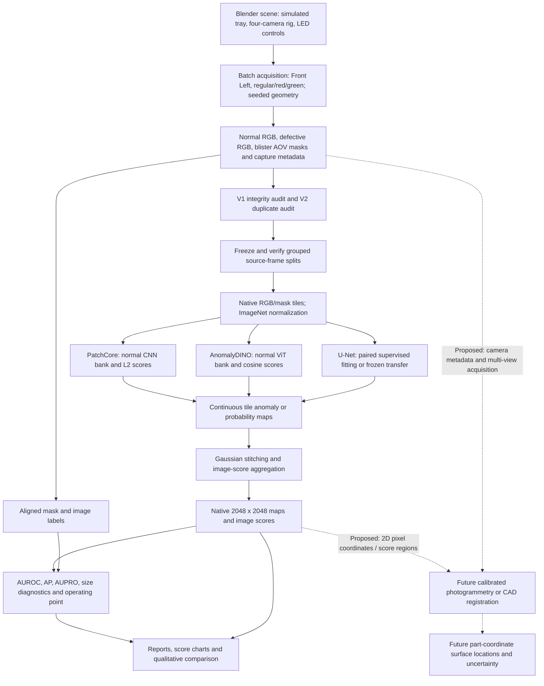
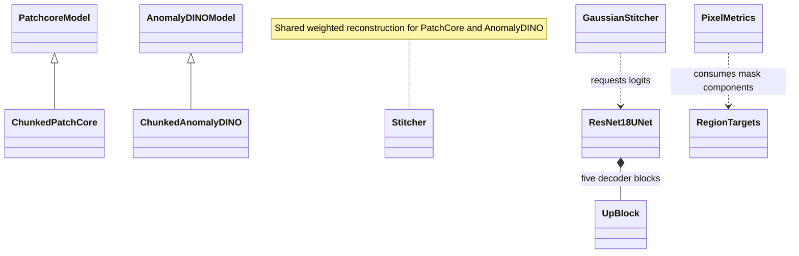
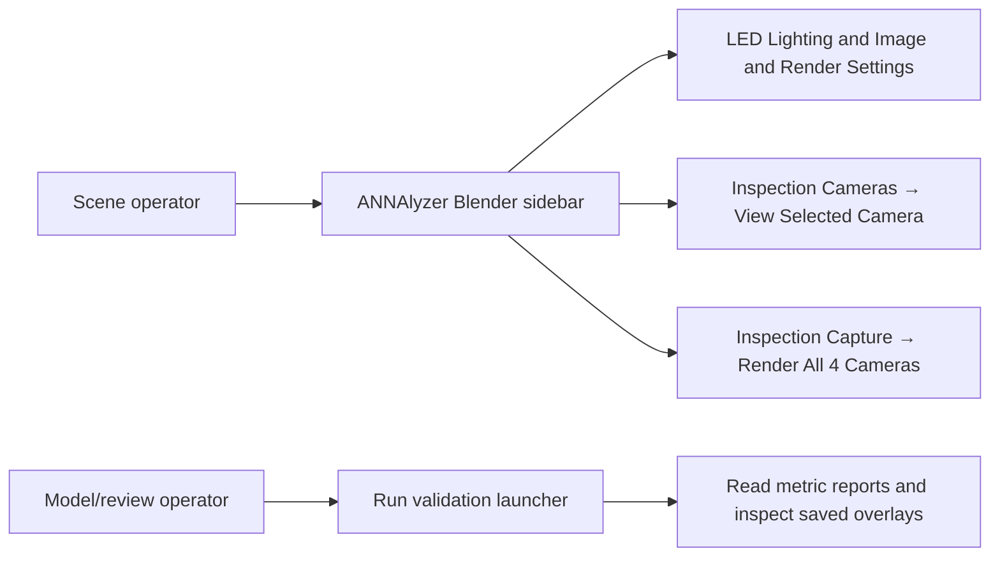

# Anomaly detection journal

## 2026-11-24 · ANNAlyzer dataset audit

Audited `data/annalyzer_batch_2048` before any Anomalib PatchCore fitting. The working folder contains the Blender scenes, render scripts and batch launcher, the completed dataset, and the anomaly-detection README. I read the root `AGENTS.md` and checked the two batch render scripts against the hashes in `dataset.json`. Both matched. The folder had no Git metadata, so there is no revision identifier for this entry. Anomalib was absent from the local Python environment examined. This entry records dataset findings and proposed experiment settings. The dataset was read in place. Dependency installation, split assignment, tile generation and model training were outside this audit.

[Repository instructions](../AGENTS.md) · [Project README](README.md) · [Dataset metadata](../data/annalyzer_batch_2048/dataset.json) · [Source sample metadata](../data/annalyzer_batch_2048/samples.json) · [Audit manifest v1](dataset_audit_manifest_v1.jsonl)

### Inventory, format and pairing

| Lighting | Normal files | Unique normal RGB | Defective RGB | Masks | Complete triples |
| --- | ---: | ---: | ---: | ---: | ---: |
| Regular | 100 | 1 | 100 | 100 | 100 |
| Red | 100 | 100 | 100 | 100 | 100 |
| Green | 100 | 100 | 100 | 100 | 100 |
| **Total** | **300** | **201** | **300** | **300** | **300** |

- All 900 expected PNGs were present, with zero unexpected data files and zero missing or extra sample records. The root contains the two JSON files and an empty `.batch.lock` marker. `dataset.json` records the batch as complete.
- All PNGs passed Pillow integrity verification and full decoding. Every image is 2048 × 2048. All 600 color images are 8 bits per channel, three-channel RGB PNGs. All 300 masks are 8-bit single-channel grayscale PNGs. Every mask contains foreground and has only values 0 and 255. All foreground counts agree with `samples.json`.
- Each lighting condition has IDs `0001`–`0100`, present in `normal`, `bubbles` and `masks`. All 300 metadata records point to their corresponding files with the same lighting and ID. In every triple, the mean absolute clean-to-defective RGB change was larger inside the mask than outside. As a spot check, overlays at the minimum, middle and maximum mask coverage per lighting condition showed plausible alignment on flange and laminate regions, including around ribs and fastener holes. The nine inspected samples were `regular/{0004,0074,0097}`, `red/{0023,0090,0012}` and `green/{0050,0088,0009}`.
- File-byte SHA-256 and decoded-pixel SHA-256 both found one duplicate group, comprising the 100 regular clean files. This is the reused fixed reference described by the renderer. The batch therefore contains **501 unique RGB images and 300 unique masks**.
- Red and green share all 100 setup IDs. For each same-ID pair, the height band, nominal camera and LED heights, effective LED height, rig and ceiling intensities, and dark-field mix match. Each color has 34 low, 33 mid and 33 high setups, including nine, eight and eight dark-field samples by band. The three conditions share the Front Left camera and tray design. All 300 defective samples have distinct seeds and distinct recorded instance lists. Regular uses one fixed setup, so its numeric ID is a file index and does not identify the same capture setup as red or green.

### Visible defect footprints at source resolution

Measured area as the number of foreground pixels and width and height as the dimensions of the tight axis-aligned bounding box of each 8-connected component. The short side is the smaller of the box width and height. Percentiles use NumPy's linear interpolation. Occlusion and ribs can fragment a single blister, and touching foreground can merge blisters. These measurements describe visible mask regions. The batch provides 3D instance metadata and a binary mask with one foreground class, so the audit reports footprints without assigning 2D regions to specific instances or surfaces. The audit retained five one-pixel components in the statistics.

| Lighting | Visible components | Component area P10 / P50 / P90 (px²) | Median width × height (px)¹ | Short side P10 / P50 / P90 (px) | Foreground per image min / median / max (px) |
| --- | ---: | ---: | ---: | ---: | ---: |
| Regular | 1,617 | 27 / 162 / 6,065 | 19 × 16 | 5 / 14 / 89 | 2,297 / 25,539.5 / 78,663 |
| Red | 1,481 | 23 / 172 / 7,452 | 20 × 15 | 4 / 13 / 96 | 959 / 28,487.5 / 92,545 |
| Green | 1,452 | 22 / 124.5 / 6,246.2 | 18 × 12 | 4 / 11.5 / 90 | 837 / 26,531 / 85,516 |
| **All** | **4,550** | **24 / 150 / 6,569.8** | **19 × 14** | **4 / 13 / 91** | **837 / 26,508 / 92,545** |

¹ Width and height medians are calculated independently. Across the batch, component areas range from 1 to 41,990 px², widths from 1 to 330 px, heights from 1 to 233 px and component counts from 8 to 23 per mask. The lowest-coverage mask occupies about 0.020% of the full frame, and the median occupies 0.632%.

### Leakage risks and planned split policy

| Configuration | Unique normal training | Unique normal validation | Unique normal testing |
| --- | ---: | ---: | ---: |
| Regular fixed reference | 1 | 0 | 0 |
| Red | 70 | 15 | 15 |
| Green | 70 | 15 | 15 |

- Use three separate Anomalib PatchCore models with the same preprocessing and model configuration. For red and green, the proposed 70/15/15 allocation applies **per lighting condition**. Assign shared numeric setup IDs first, with one assignment reused across both colors and all files in each triple. Preserve representation of the height bands and partial dark-field setups. Only normal training images enter the memory bank. Validation and test use normal and defective samples and their available masks. Any threshold calibration uses validation data only.
- In regular, fit from one unique reference and use defective images for fixed-reference evaluation. Copies associated with held-out anomalies must stay outside the validation and test normal cohorts. Image-level AUROC and an independent normal false-positive rate are unavailable for the regular configuration. Any future defect-based threshold calibration needs held-out defects of its own.
- Split whole source groups before tiling or augmentation. Overlapping tiles from one source share pixels. The same tray, worktop, camera orientation and parts of the lighting schedule recur across samples. Among the distinct red normals, the nearest pair in 64 × 64 RGB thumbnail RMSE was `0091`/`0094` at 4.35 intensity levels on the 0–255 scale. The same IDs were nearest in green at 4.34. This coarse similarity screen flags a pair to review when making assignments. It does not establish a near-duplicate threshold. Recheck exact hashes and visual or image similarity across the assigned folds at that stage.
- Red versus green uses matched capture settings and independently generated defects, so compare performance on similar setup distributions. Regular versus colored runs also change placement, illumination intensity, dark-field use and the size of the clean reference set. All results on this batch characterize one synthetic tray and inspection cell. Generalization to new physical parts or cells requires independent data.

### Initial PatchCore input recommendation

**Use 512 × 512 RGB tiles at native resolution with 25% overlap.** The overlap is 128 px and the stride is 384 px. Tile starts in each axis are 0, 384, 768, 1,152 and 1,536, giving a 5 × 5 grid with full frame coverage and no padding. Crop masks at the same original coordinates. Use identical input geometry for fitting and inference, retain all edge tiles, and start with batch size 1 for the later memory check. For full-image evaluation, use the mean of continuous anomaly-map values in overlapping regions as the initial stitching rule and evaluate on the 2048 × 2048 canvas. The geometric coverage check found that 4,511 of 4,550 component bounding boxes fit entirely in at least one tile. The other 39 span multiple tiles, which makes evaluating the stitched canvas particularly important.

The median component short side is 13 px, with a 10th percentile of 4 px. At a full-frame resize to 256 × 256 these spans project to roughly 1.6 px and 0.5 px. At 512 × 512 full-frame they project to 3.25 px and 1 px. The standard Wide ResNet `layer2` and `layer3` feature grids have nominal strides of 8 and 16 input pixels. One `layer2` interval corresponds to 64 source pixels for a 256 × 256 full-frame input, 32 for a 512 × 512 full-frame input, and 8 with native tiles. Respectively, 3,707 (81.5%), 2,957 (65.0%) and 1,551 (34.1%) of the measured short sides fall below one such interval. This scale comparison is a geometric estimate of localization difficulty, and tiny defects can still challenge the tiled setup. [TorchVision ResNet source](https://docs.pytorch.org/vision/stable/_modules/torchvision/models/resnet.html)

Set Anomalib preprocessing explicitly to preserve each tile at 512 × 512 and retain the full tile field of view. The documented Anomalib default resize is 256 × 256, and the original PatchCore example resizes to 256 then crops to 224. For the later baseline, `AGENTS.md` specifies frozen ImageNet-pretrained `wide_resnet50_2`, `layer2` and `layer3`, and coreset ratio `0.1`. Confirm the actual tensors and feature shapes with a future small fit and inference run. Batch size controls per-step inputs, while total tiling volume also affects the accumulated memory bank. Resolution, throughput and model accuracy remain unbenchmarked. [Anomalib PatchCore reference](https://anomalib.readthedocs.io/en/stable/markdown/guides/reference/models/image/patchcore.html) · [Original PatchCore implementation](https://github.com/amazon-science/patchcore-inspection)

### Audit record

The versioned JSON Lines manifest contains one row per verified triple. Paths are relative to `data/annalyzer_batch_2048`. Each row contains its sample identity, synthetic scene and tray design, camera and capture setup, defect seed and instances, file labels, mask pairing, both hash types and measured mask pixel and component counts. Decoded-pixel hashes cover the decoded mode string followed by the row-major pixel bytes. No split field is assigned. The file was reloaded and validated as 300 unique records with the expected paths and mask references.

The audit used Python 3.14 with Pillow 12.1.0, NumPy 2.4.0, OpenCV 5.0.0 and SciPy 1.16.3 already present. The dataset metadata SHA-256 values were as follows.

| File | SHA-256 |
| --- | --- |
| `dataset.json` | `252d185b66dcc29d3503f8f0e8527e1ab3059f6c4b84fb7cd3cded1277fbaa72` |
| `samples.json` | `a80f54f02f8832f4ac830f05759a0e7959fdf55b5726eef8bbb04cd2d6e5bf63` |

## 2026-11-24 · Phase 2 PatchCore feasibility

The regular-lighting smoke test passed on the RTX 4060 Laptop GPU. The isolated environment uses Python 3.12.13, PyTorch 2.9.1+cu128, TorchVision 0.24.1+cu128, CUDA runtime 12.8, cuDNN 9.10.2 and Anomalib 2.2.0. The NVIDIA driver reported 621.14. PyTorch executed an FP32 CUDA operation successfully. The GPU reported 8,187.5 MiB total VRAM and 7,060 MiB free after its startup probe. The host reported 15,554 MiB RAM. Stock Anomalib initially failed to import because its bundled video models implicitly require Requests. Adding Requests to the isolated lock resolved the issue, and the final dependency check passed for all 80 packages.

[Setup and run instructions](patchcore/V1/README.md) · [Pinned lockfile](patchcore/V1/uv.lock) · [Machine-readable run report](patchcore/results/V1/regular_smoke_20261124T072401_611224Z/report.json) · [Heatmaps and ground-truth comparison](patchcore/results/V1/regular_smoke_20261124T072401_611224Z/comparison.png) · [Fitted state](patchcore/results/V1/regular_smoke_20261124T072401_611224Z/fitted_state.pt)

### Smoke test

From `Anamoly_detection/patchcore`, the run command was `.\.venv\Scripts\python.exe -u smoke.py`. The fit used `regular/normal/0001.png` as the sole normal reference. The three defective smoke inference cases were `regular/0004`, `regular/0074` and `regular/0097`, selected to span low, middle and high foreground coverage. The reference, defective images and masks matched the audit manifest hashes. These cases are qualitative diagnostics and were assigned no experimental fold. Dataset metadata hashes still match the audit.

- Extracted 25 native RGB tiles per image using 512 × 512 tiles, 128 px overlap and a 384 px stride. The model received FP32 `[1, 3, 512, 512]` tensors with TF32 disabled. Preprocessing used ImageNet channel mean and standard deviation with no resize or center crop.
- Loaded frozen TorchVision WideResNet50-2 with `IMAGENET1K_V2` weights from the official checkpoint. Its SHA-256 was `9ba9bcbebc349d733a72eb7608143fd754e4689ac8d8ce2916ca0bdff6443950`. Observed `layer2` shape `[1, 512, 64, 64]`, `layer3` shape `[1, 1024, 32, 32]`, and 4,096 × 1,536 FP32 embeddings per tile.
- The 25 reference tiles produced 102,400 candidates. With seed 24117 and Anomalib's projected greedy k-center at 0.10, the fitted bank was **10,240 × 1,536 FP32**, or **60 MiB**. The exact chunked Euclidean search passed a comparison with the stock dense search for one and nine neighbors. The reloaded fitted state reproduced all map pixels and tile scores exactly on the `regular/0004` frame.
- All three saved 2048 × 2048 FP32 maps were finite. Raw maps average overlapping tile scores per pixel. Visual PNGs share a single 0–25.7813 display scale across all three images. In the spot check, larger laminate lifts produced distinct peaks, and some small flange regions showed localized responses. Background texture and visible rectangular tile seams also produced responses. Treat seam handling as a validation question before interpreting small-defect localization. Diagnostic means below use the original ground-truth masks, with no threshold calibration or ranking metrics.

| Smoke image | Peak stitched map value | Mean inside mask | Mean outside mask | Frame score¹ |
| --- | ---: | ---: | ---: | ---: |
| `regular/0004` | 19.96 | 11.49 | 6.51 | 21.20 |
| `regular/0074` | 21.55 | 13.50 | 6.56 | 22.55 |
| `regular/0097` | 25.78 | 14.04 | 6.62 | 25.75 |

¹ The frame score is the maximum of Anomalib's weighted tile scores. The raw stitched map and the frame score use separate aggregations.

### Measured resources

| Stage | Wall time | Peak CUDA allocated | Peak CUDA reserved | Peak process RAM |
| --- | ---: | ---: | ---: | ---: |
| Extract 25 normal tiles | 0.75 s | 915 MiB | 996 MiB | 1,726 MiB |
| Fit coreset and verify chunked search | 16.74 s | 1,473 MiB | 1,820 MiB | 1,976 MiB |
| Inference and stitch per 2048 × 2048 frame | 1.11–1.12 s | 453 MiB | 1,822 MiB | 2,096–2,167 MiB |
| Save and reload state, verify one frame | 2.27 s | 524 MiB | 1,832 MiB | 2,302 MiB |
| Save visual outputs | 2.39 s | 432 MiB | 1,832 MiB | 2,316 MiB |

These are synchronized stage timings and PyTorch allocator peaks. Reserved VRAM includes the pool retained from earlier stages. Process RAM is the sampled working set at 50 ms intervals. The report preserves all stages individually, including backbone load. The listed stages plus backbone load total about 26.25 s of measured work, excluding Python imports and input decoding outside the timed stages.

### Red and green feasibility

Estimates are **per color**, based on the measured feature shape. Seventy unique normals per color are planned for fitting. The 100-image column describes the entire available normal inventory for sizing only.

| FP32 memory or count | 70 normals per color | 100 normals per color |
| --- | ---: | ---: |
| Tile count | 1,750 | 2,500 |
| Candidate rows | 7,168,000 | 10,240,000 |
| Raw candidates | 41.02 GiB | 58.59 GiB |
| Stock concatenate lower bound¹ | 82.03 GiB | 117.19 GiB |
| Projected matrix alone¹ | 10.39 GiB | 15.18 GiB |
| Final 10% bank | 4.10 GiB | 5.86 GiB |
| Unchunked distance matrix per tile | 10.94 GiB | 15.63 GiB |
| Chunked distance block alone | 16 MiB | 16 MiB |

¹ The stock implementation retains per-batch tensors while forming the contiguous candidate tensor. K-center then creates the projected matrix and uses additional scratch space. These are tensor storage estimates without Python, model, allocator, or OS overhead. The stock fit exceeds both the host RAM and GPU VRAM budgets. Keeping only a final 10% bank would still consume 4.10 GiB of VRAM per color and incur a large search cost even with distance chunking. [Anomalib 2.2 coreset implementation](https://github.com/open-edge-platform/anomalib/blob/v2.2.0/src/anomalib/models/components/sampling/k_center_greedy.py) · [PatchCore storage and search code](https://github.com/open-edge-platform/anomalib/blob/v2.2.0/src/anomalib/models/image/patchcore/torch_model.py)

**Recommended next feasibility step.** Process one color at a time and stream a seeded spatially stratified sample of **64 candidates per tile** to host memory. Draw one feature vector per cell of an 8 × 8 grid on the feature map so every tile and every planned normal training view contributes. For 70 images, this bounds the input to 112,000 rows and **656.25 MiB** of original embeddings. A projected greedy k-center pass retaining 10% of those candidates would yield 11,200 rows and **65.63 MiB** of final FP32 bank storage. Keep bounded exact search. Apply the same policy and seed to both colors, and use validation to check localization on small components, seam behavior and the benefit of a larger candidate budget before finalizing the sampling method. These are projected resource bounds for the proposed candidate policy. Phase 2 ran only the single-reference smoke fit and left the original dataset and full-scale experiment untouched.

## 2026-11-24 · Phase 3 grouped split and red-lighting optimization

### Split and experiment design

The frozen split uses seed 24117 and assigns 70 training, 15 validation and 15 test setup IDs to each of red and green. The two colors use the exact same assignment. Each validation and test fold has five setups per height band, including one partial dark-field setup in each band. Normal images, defective images and masks stay together within each colored setup. The previously identified near-duplicate pair `0091` and `0094` stays together in training. The script rebuilds the same assignments from the audited manifest and checks decoded-pixel hashes for leakage across colored folds. [Split manifest](patchcore/V1/split_v1.json) · [Split generator](patchcore/V1/split_dataset.py)

The regular cohort keeps `regular/normal/0001.png` as the one fixed normal reference and excludes the other 99 clean copies. The three inspected defects `regular/0004`, `regular/0074` and `regular/0097` are development/validation images. The other 97 regular defective images are reserved for test. Phase 3 evaluated red validation only. The red, green and regular final test images remained untouched. The green and regular assignments are recorded for future runs.

The two banks used only the same 70 verified red normal images. The pretrained WideResNet50-2, `layer2` and `layer3`, batch size 1, native 512 × 512 tiles, 128 px overlap, FP32, and 10% projected greedy k-center coreset were held fixed. On each 64 × 64 feature grid, an 8 × 8 array of spatial strata supplied one seeded vector per stratum for the 64-candidate pool. The 128-candidate pool added a second distinct vector in each stratum and contained every candidate from the smaller pool. For each bank, both stitchers used the same tile predictions. Uniform averaging gives every overlapping tile the same weight. Gaussian stitching uses separable center weights with sigma 128 px per axis and divides by the local sum of weights. No calibration threshold was fitted.

Pixel AUROC and AP pool full-frame pixels across 15 clean and 15 defective red validation images. AUPRO integrates equally weighted 8-connected component overlap up to a pooled background-pixel FPR of 30% and divides by 0.30. Size bands use component area below 64, 64–511 and at least 512 px². The size-specific curves use the same background FPR and also report mean component overlap at a diagnostic 1% FPR. Metrics use 65,536 shared score bins over the full continuous score range, with a half-resolution sensitivity check. The seam diagnostic compares the mean absolute adjacent-pixel score step at internal tile boundaries against parallel controls 16 px away, on the 15 clean validation images. [AUPRO convention](https://www.mvtec.com/fileadmin/Redaktion/mvtec.com/05_research_teaching/Batzner_EfficientAD_Accurate_Visual_Anomaly_Detection_at_Millisecond_Level_Latencies_WACV_2024_paper.pdf)

Run from `Anamoly_detection/patchcore` using the existing Phase 2 environment.

```powershell
.\.venv\Scripts\python.exe split_dataset.py
.\.venv\Scripts\python.exe -u phase3.py
```

### Red validation results

| Candidates per tile | Stitching | Pixel AUROC | Pixel AP | AUPRO at 30% FPR | Mean seam step |
| ---: | --- | ---: | ---: | ---: | ---: |
| 64 | Uniform | 0.8638 | 0.1719 | 0.6148 | 0.8460 |
| 64 | Gaussian | 0.8609 | 0.1763 | 0.6041 | 0.3207 |
| 128 | Uniform | 0.9469 | 0.2874 | 0.8141 | 0.7672 |
| **128** | **Gaussian** | **0.9486** | **0.2960** | **0.8177** | **0.2942** |

There were 457,885 positive and 125,371,235 background pixels. Halving the histogram resolution changed the reported pixel metrics by at most 0.000020. Image AUROC/AP from the maximum weighted tile score were 0.8311/0.8554 with 64 candidates and 0.9200/0.9314 with 128. This image score is shared by both stitchers.

| Candidates and stitch | Small AUPRO / overlap¹ (78) | Medium AUPRO / overlap¹ (58) | Large AUPRO / overlap¹ (86) |
| --- | ---: | ---: | ---: |
| 64 uniform | 0.472 / 0.180 | 0.800 / 0.647 | 0.619 / 0.326 |
| 64 Gaussian | 0.454 / 0.176 | 0.798 / 0.645 | 0.609 / 0.328 |
| 128 uniform | 0.731 / 0.341 | 0.889 / 0.751 | 0.839 / 0.514 |
| 128 Gaussian | 0.733 / 0.326 | 0.894 / 0.754 | 0.843 / 0.519 |

¹ Mean component overlap at 1% pooled background FPR. The counts in parentheses refer to visible mask components. The 128-candidate Gaussian setup led on aggregate and size-specific AUPRO. Uniform stitching with 128 candidates retained a 1.5 percentage-point advantage in small-component overlap at the 1% diagnostic FPR. Small components remained the hardest group for either stitcher.

At 128 candidates, Gaussian weighting lowered the mean seam step by 61.7%. Relative to the nearby control step, the seam dropped from 10.46× to 4.17×. The comparison shows softer rectangular boundaries and persistent responses on tray ribs and background structures. The full-resolution heatmaps share one visual scale from 0 to 27.2401. Metrics use the raw stitched scores. Extract the archives into the run directory to recover its `visuals/` and `raw/` outputs. [Visual comparison](patchcore/results/V1/red_phase3_20261124T075750_651308Z/comparison.png) · [Validation figures ZIP](patchcore/results/V1/red_phase3_20261124T075750_651308Z/validation_figures.zip) · [Raw score maps ZIP](patchcore/results/V1/red_phase3_20261124T075750_651308Z/raw_score_maps.zip) · [Run report](patchcore/results/V1/red_phase3_20261124T075750_651308Z/report.json)

### Measured resources

Shared extraction from the 70 red training normals took 34.12 s. The peak sampled process RAM was 3,038 MiB, and the PyTorch allocator peaked at 345 MiB allocated and 398 MiB reserved. Both candidate budgets were extracted in this one pass.

| Candidates per tile | Candidate vectors | Fitted bank | Coreset time | Fit RAM peak | Fit VRAM allocated / reserved | Mean inference and stitch | Inference RAM peak |
| ---: | ---: | --- | ---: | ---: | ---: | ---: | ---: |
| 64 | 112,000 | 11,200 × 1,536 · 65.63 MiB | 20.13 s | 3,149 MiB | 2,070 / 2,112 MiB | 1.18 s/frame | 3,532 MiB |
| 128 | 224,000 | 22,400 × 1,536 · 131.25 MiB | 83.35 s | 3,360 MiB | 3,883 / 3,918 MiB | 1.89 s/frame | 3,592 MiB |

Shared extraction plus coreset took 54.25 s for the 64-candidate budget and 117.47 s for 128. Per-frame inference includes tile inference and one stitch and excludes PNG decoding, map writes, and metric calculations. The 128 inference stage peaked at 510 MiB allocated and 632 MiB reserved. The first run completed fitting and inference but stopped at a type error during overlay export. The visualization fix passed an end-to-end synthetic check, then the full comparison completed in a new directory. Both saved banks and spot-checked 64-candidate raw maps matched the first attempt byte for byte.

### Configuration selected on red validation

Use **128 spatially stratified candidates per tile, a 10% coreset, and Gaussian stitching with sigma 128 px per axis**. The larger bank improved localization across size bands and fitted within the RTX 4060 memory budget. Gaussian stitching improved all three pooled pixel metrics at that budget and substantially reduced the measured seam step. Check the selected configuration on the matched green validation fold before drawing cross-lighting conclusions. The red result is based on 15 synthetic validation setups using one seed. Final test evaluation remains reserved.

## 2026-11-24 · Preliminary PatchCore benchmark across lighting conditions

### Fixed configuration and cohorts

Used the selected Phase 3 configuration for both new fits and carried forward the saved red validation scores and bank. The shared pipeline uses frozen ImageNet-pretrained WideResNet50-2 `layer2` and `layer3`, native 512 × 512 RGB tiles with a 128 px overlap, ImageNet channel normalization, FP32 with TF32 disabled, batch size 1, 128 spatially stratified candidates per tile, a 10% projected greedy k-center coreset, nine-neighbor weighted tile scores, exact chunked search, seed 24117, and Gaussian stitching with sigma 128 px per axis. The shared finite-value assertion now checks candidates in chunks to avoid a large temporary GPU allocation. Candidate selection and coreset computation are unchanged. [Frozen split](patchcore/V1/split_v1.json) · [Selected red reference report](patchcore/results/V1/red_phase3_20261124T075750_651308Z/report.json) · [Benchmark runner](patchcore/V1/lighting_benchmark.py)

Red and green each use the same 70 training capture IDs and 15 validation capture IDs, with one clean and one defective image per validation setup. Regular uses only `regular/normal/0001.png` for training. Its three validation defects are `regular/0004`, `regular/0074` and `regular/0097`. Regular image AUROC and image AP are N/A because the regular protocol has no independent clean validation frame. Its pixel metrics use foreground and background pixels from the three defective frames. This differs from the red and green pixel cohorts, which also include 15 clean frames each. The split and source dataset were retained as recorded. The reserved test cohorts remained outside fitting and validation.

All frames use the Front Left inspection camera. Regular has a fixed camera height of 1.610 m, a nominal LED height of 1.102 m, base rig and ceiling intensities of 1.0, and no dark-field mixing. The colored training sets share camera heights of 1.281–1.608 m and nominal LED heights of 1.103–1.592 m. The colored validation sets share camera heights of 1.315–1.605 m and nominal LED heights of 1.118–1.536 m. Effective LED heights in the colored validation sets range from 1.084–1.536 m, and three of the 15 validation setups use partial dark field. The two colored cohorts match in placement and recorded intensity schedule at each ID and generate defects independently. The regular condition additionally differs in training coverage, view geometry and the size of its validation cohort.

The benchmark uses the Phase 3 full-frame metrics, including AUPRO at 30% pooled background FPR and size-specific component overlap at a diagnostic 1% FPR. Each score histogram uses 65,536 bins spanning its validation score range, with the saved red metrics retained at their original bin range. Scores remain continuous in the saved maps. A shared display scale is used for the three-color heatmap comparison. No operating threshold was calibrated.

Run from `Anamoly_detection/patchcore` after the Phase 2 environment is installed. The runner expects the existing red raw maps and overlays alongside the Phase 3 report. The archived copies can be extracted into the original red run directory.

```powershell
.\.venv\Scripts\python.exe -u lighting_benchmark.py
```

### Consolidated validation results

| Lighting | Training normals | Validation normal / defective | Pixel AUROC | Pixel AP | AUPRO at 30% FPR | Image AUROC | Image AP |
| --- | ---: | ---: | ---: | ---: | ---: | ---: | ---: |
| Regular | 1 | 0 / 3 | 0.8061 | 0.0534 | 0.7015 | N/A | N/A |
| Red | 70 | 15 / 15 | 0.9486 | 0.2960 | 0.8177 | 0.9200 | 0.9314 |
| Green | 70 | 15 / 15 | 0.9455 | 0.2930 | 0.8346 | 0.9156 | 0.9220 |

| Lighting | Recorded flange / laminate instances | Visible mask components | Positive pixels |
| --- | ---: | ---: | ---: |
| Regular | 27 / 18 | 50 | 106,761 |
| Red | 125 / 82 | 222 | 457,885 |
| Green | 131 / 74 | 223 | 482,793 |

Instance totals count generated geometry. Connected components count visible mask regions, which can split around ribs or occlusions. Red and green use the same setup schedule with independently seeded defects, so their modest metric differences reflect both lighting color and differences in the rendered defects. Across the matched setup cohorts, red had slightly higher pixel and image ranking scores, and green had higher region overlap. The regular heatmaps showed strong responses along ribs, rims and background edges. Its small cohort, single clean reference and fixed setup limit direct comparison with the colored cohorts.

| Lighting | Small components¹ | Medium components¹ | Large components¹ |
| --- | ---: | ---: | ---: |
| Regular | 14 · 0.843 / 0.150 | 15 · 0.743 / 0.394 | 21 · 0.578 / 0.102 |
| Red | 78 · 0.733 / 0.326 | 58 · 0.894 / 0.754 | 86 · 0.843 / 0.519 |
| Green | 88 · 0.779 / 0.372 | 49 · 0.904 / 0.718 | 86 · 0.852 / 0.554 |

¹ Each cell gives the component count, AUPRO at 30% FPR, and mean overlap at 1% FPR. Size bands use visible area below 64, 64–511 and at least 512 px². Regular's small-component AUPRO is based on 14 regions and its mean small-component overlap at 1% FPR is 0.150. Halving histogram resolution changed the reported pooled pixel metrics by at most 0.000020 across the three results.

### Fitted models and artifacts

| Lighting | Candidate vectors | Fitted bank | Extraction / coreset time | Mean validation inference and stitch |
| --- | ---: | --- | ---: | ---: |
| Regular | 3,200 | 320 × 1,536 · 1.875 MiB | 1.68 / 0.50 s | 0.67 s/frame |
| Red | 224,000 | 22,400 × 1,536 · 131.25 MiB | 34.12 / 83.35 s | 1.89 s/frame |
| Green | 224,000 | 22,400 × 1,536 · 131.25 MiB | 34.92 / 85.22 s | 1.88 s/frame |

The red resource measurements are from Phase 3. Green peaked at 2,206 MiB allocated VRAM during coreset selection and 3,432 MiB sampled process RAM during extraction. The consolidated report stores per-stage allocator and working-set measurements and the hashes of all three standalone fitted states. The red state was packaged with the saved Phase 3 bank and original backbone weights. Its historical metrics, raw scores and bank were retained.

[Comparison CSV](patchcore/results/V1/lighting_benchmark_20261124T084630_908213Z/comparison.csv) · [Consolidated report](patchcore/results/V1/lighting_benchmark_20261124T084630_908213Z/report.json) · [Validation metric chart](patchcore/results/V1/lighting_benchmark_20261124T084630_908213Z/validation_metrics.png) · [Defect-size chart](patchcore/results/V1/lighting_benchmark_20261124T084630_908213Z/defect_size_metrics.png) · [Heatmaps and ground-truth panel](patchcore/results/V1/lighting_benchmark_20261124T084630_908213Z/lighting_heatmaps.png)

[Fitted regular model](patchcore/results/V1/lighting_benchmark_20261124T084630_908213Z/regular/fitted_state.pt) · [Fitted red model](patchcore/results/V1/lighting_benchmark_20261124T084630_908213Z/red/fitted_state.pt) · [Fitted green model](patchcore/results/V1/lighting_benchmark_20261124T084630_908213Z/green/fitted_state.pt)

## 2026-11-24 · Model 2 AnomalyDINO

The PatchCore freeze records SHA-256 hashes for its implementation, split, lockfile, environment metadata, pretrained weights, and all files in the three completed runs. AnomalyDINO uses its own `.venv`, package lock, model cache and output directories. The AnomalyDINO runner reads the frozen split, cohort records, stitcher, evaluator and saved PatchCore report. [Freeze manifest](anomalydino/V1/patchcore_freeze_v1.json) · [AnomalyDINO setup](anomalydino/V1/README.md) · [Runner](anomalydino/V1/run.py)

The AnomalyDINO environment uses Python 3.12.13, Anomalib 2.5.1, timm 1.0.27, PyTorch 2.9.1+cu128 and TorchVision 0.24.1+cu128. The backbone is the frozen DINOv2 ViT-S/14 checkpoint `vit_small_patch14_dinov2.lvd142m`, pinned by revision and SHA-256. Fitting uses normal samples only, with foreground masking and reference augmentation disabled. Anomalib 2.5.1's k-center includes its seeded initial center in the returned bank. [Anomalib AnomalyDINO reference](https://anomalib.readthedocs.io/en/lib-v2.5.1/markdown/guides/reference/models/image/anomaly_dino.html) · [Pinned encoder weights](https://huggingface.co/timm/vit_small_patch14_dinov2.lvd142m/blob/4610ca143709d58a633b6397a74412c2c3842454/model.safetensors)

AnomalyDINO keeps the original 512 × 512 tile coordinates, 128 px overlap, ImageNet RGB normalization, FP32, batch size 1, seed 24117 and Gaussian stitching with sigma 128 px. Reflection padding adds three pixels per side so the encoder receives 518 × 518 while preserving every native pixel. The last transformer block supplies 37 × 37 tokens of width 384. The border is removed from each generated map before stitching. For each tile the fit takes 128 spatially stratified tokens, two per cell of an 8 × 8 partition of the token grid, and applies the 10% projected greedy k-center coreset. Cosine search uses one nearest neighbor with 512-query and 8,192-bank chunks. AnomalyDINO's tile score is the mean of the top 1% of token distances. The frame score is the maximum of its tile scores. These model-specific choices replace PatchCore's convolutional features, Euclidean search and weighted tile score.

The CUDA smoke test fitted 12 bank vectors from one red normal tile and evaluated a red validation tile. It confirmed the 518 × 518 encoder input, 1,369 × 384 patch features, and aligned 512 × 512 output. The maximum difference between chunked and stock dense Anomalib maps was 3.58e-7. Reloading the saved state reproduced the smoke map exactly. The full runs use the identical red, green and regular validation cohorts and pixel metric definitions as PatchCore. Regular image AUROC and AP are N/A because its validation fold has zero independent clean frames. The final test sets remain reserved.

### Validation results

| Lighting | Model | Pixel AUROC | Pixel AP | AUPRO at 30% FPR | Image AUROC | Image AP |
| --- | --- | ---: | ---: | ---: | ---: | ---: |
| Regular | PatchCore | 0.8061 | 0.0534 | 0.7015 | N/A | N/A |
| Regular | AnomalyDINO | 0.7437 | 0.0824 | 0.5385 | N/A | N/A |
| Red | PatchCore | 0.9486 | 0.2960 | 0.8177 | 0.9200 | 0.9314 |
| Red | AnomalyDINO | 0.8378 | 0.1346 | 0.6304 | 0.8711 | 0.8857 |
| Green | PatchCore | 0.9455 | 0.2930 | 0.8346 | 0.9156 | 0.9220 |
| Green | AnomalyDINO | 0.8317 | 0.1656 | 0.6867 | 0.8667 | 0.8873 |

| Lighting | Small AUPRO / overlap¹ | Medium AUPRO / overlap¹ | Large AUPRO / overlap¹ |
| --- | ---: | ---: | ---: |
| Regular | 0.706 / 0.157 | 0.614 / 0.200 | 0.373 / 0.127 |
| Red | 0.548 / 0.409 | 0.790 / 0.692 | 0.597 / 0.326 |
| Green | 0.687 / 0.526 | 0.791 / 0.653 | 0.627 / 0.344 |

¹ These are AnomalyDINO results. Each cell gives AUPRO at 30% pooled background FPR and mean visible-component overlap at a diagnostic 1% FPR, using the same <64, 64–511, and ≥512 px² bins as PatchCore. Halving score-histogram resolution changed AnomalyDINO's pooled metrics by at most 0.000009.

PatchCore led on aggregate AUPRO in all three conditions and on both colored image-level metrics. AnomalyDINO had higher pixel AP on the three regular defects. At the stricter 1% background FPR, AnomalyDINO also recovered more pixels within small components on red (0.409 versus 0.326 mean overlap) and green (0.526 versus 0.372). These observations describe fixed synthetic validation cohorts and the selected single configuration for each method.

### Fitted states and resources

| Lighting | Candidate vectors | Fitted bank | Candidate extraction / coreset | Mean inference and stitch |
| --- | ---: | ---: | ---: | ---: |
| Regular | 3,200 | 320 × 384 · 0.469 MiB | 0.89 / 0.08 s | 0.59 s/frame |
| Red | 224,000 | 22,400 × 384 · 32.81 MiB | 44.48 / 83.88 s | 0.66 s/frame |
| Green | 224,000 | 22,400 × 384 · 32.81 MiB | 43.99 / 83.90 s | 0.67 s/frame |

The RTX 4060 run peaked at 955 MiB of allocated CUDA memory and 1,993 MiB of sampled process RAM. Red and green inference took about one third of the measured PatchCore time on the same cohorts. The saved state for each condition includes its frozen encoder and fitted bank. Each bank was confirmed after reloading the state. The report includes individual scores, runtime and environment measurements, and model hashes. The display heatmaps use a common AnomalyDINO range. The raw maps preserve the original cosine-distance score scale.

Ran `.\.venv\Scripts\python.exe -u run.py` from `Anamoly_detection/anomalydino`. Rechecking the PatchCore freeze after the benchmark matched all 447 fingerprints.

[Consolidated report](anomalydino/results/V1/anomalydino_20261124T091730_300718Z/report.json) · [Cross-model metrics CSV](anomalydino/results/V1/anomalydino_20261124T091730_300718Z/model_comparison.csv) · [Cross-model metric chart](anomalydino/results/V1/anomalydino_20261124T091730_300718Z/model_comparison.png) · [Defect-size chart](anomalydino/results/V1/anomalydino_20261124T091730_300718Z/defect_size_comparison.png) · [Heatmaps and ground-truth panel](anomalydino/results/V1/anomalydino_20261124T091730_300718Z/lighting_heatmaps.png)

[Fitted regular state](anomalydino/results/V1/anomalydino_20261124T091730_300718Z/regular/fitted_state.pt) · [Fitted red state](anomalydino/results/V1/anomalydino_20261124T091730_300718Z/red/fitted_state.pt) · [Fitted green state](anomalydino/results/V1/anomalydino_20261124T091730_300718Z/green/fitted_state.pt)

## 2026-11-24 · Model 3 supervised U-Net

PatchCore and AnomalyDINO are the frozen comparison references. Their implementation, environment metadata, fitted states and completed outputs are fingerprinted separately. U-Net uses its own pinned Python 3.12.13, PyTorch 2.9.1+cu128 and TorchVision 0.24.1+cu128 environment. [PatchCore freeze](anomalydino/V1/patchcore_freeze_v1.json) · [AnomalyDINO freeze](unet/V1/anomalydino_freeze_v1.json) · [U-Net setup](unet/V1/README.md)

The encoder is ResNet18 initialized with TorchVision ImageNet1K V1 weights. The U-Net decoder uses skip connections and fixed channel widths of 128, 64, 32, 16 and 8 from coarse to fine. Both encoder and decoder are trainable. Loss is BCE with logits plus per-tile soft Dice loss with smoothing 1 and equal coefficients. AdamW uses learning rate 1e-4 and weight decay 0.01. Each lighting fit uses 10 epochs, batch size 4, CUDA FP16 autocast and gradient scaling, FP32 loss and maps, and seed 24117. The batch-size-4 forward and backward smoke test passed at native tile size.

Red and green each use 70 normal and 70 defective audited source images from the frozen training IDs. Each epoch visits all 3,500 native training tiles in a seeded shuffle. Clean targets are all zero, and defective targets use the source binary masks. The 15 clean and 15 defective frames of each colored validation fold are used to select the highest full-frame pixel AP, with the earliest checkpoint winning ties. Regular is a separately labeled red-to-regular transfer evaluation on the three existing development defects. Zero regular frames enter fitting or checkpoint selection. The final test folds remain reserved.

All three methods share the frozen split and validation cohorts, 512 × 512 source coordinates, 128 px overlap, Gaussian stitching with sigma 128 px, and the same pixel and connected-component metric definitions. U-Net's one-channel logits become probabilities before stitching. Image score is the maximum across tiles of the mean of the top 1% of tile probabilities. Pixel AP selection and final U-Net metrics use 65,536 bins across the full [0, 1] probability range. Prior results retain their original score ranges. Regular image AUROC and AP are N/A for all three methods because the validation cohort has zero independent normals. The U-Net transfer also differs in which lighting trained the model and in labelled defect supervision.

Run from `Anamoly_detection/unet` using the locked environment.

```powershell
.\.venv\Scripts\python.exe -u run.py
.\.venv\Scripts\python.exe -u render_results.py <run-directory>
```

### Three-model validation comparison

| Validation lighting | Model and training protocol | Pixel AUROC | Pixel AP | AUPRO at 30% FPR | Image AUROC | Image AP |
| --- | --- | ---: | ---: | ---: | ---: | ---: |
| Regular | PatchCore, fixed normal reference | 0.8061 | 0.0534 | 0.7015 | N/A | N/A |
| Regular | AnomalyDINO, fixed normal reference | 0.7437 | 0.0824 | 0.5385 | N/A | N/A |
| Regular | U-Net, red-to-regular transfer | 0.9586 | 0.7834 | 0.8198 | N/A | N/A |
| Red | PatchCore, normal-only | 0.9486 | 0.2960 | 0.8177 | 0.9200 | 0.9314 |
| Red | AnomalyDINO, normal-only | 0.8378 | 0.1346 | 0.6304 | 0.8711 | 0.8857 |
| Red | U-Net, supervised red | 0.9090 | 0.7456 | 0.5897 | 0.9733 | 0.9810 |
| Green | PatchCore, normal-only | 0.9455 | 0.2930 | 0.8346 | 0.9156 | 0.9220 |
| Green | AnomalyDINO, normal-only | 0.8317 | 0.1656 | 0.6867 | 0.8667 | 0.8873 |
| Green | U-Net, supervised green | 0.9056 | 0.7408 | 0.8099 | 1.0000 | 1.0000 |

U-Net had the highest pixel AP and colored image-level scores on these validation folds. PatchCore had the highest pixel AUROC and aggregate AUPRO on both colored folds. In particular, red U-Net was effective on the largest mask regions and had substantially lower overlap on small regions. The three-frame regular transfer result uses the red model selected on red validation. Its supervised source training and the smaller regular validation cohort make it a separate protocol from the one-reference regular baselines. The perfect green image ranking is based on the 30 synthetic validation frames.

| U-Net validation lighting | Small AUPRO / overlap¹ | Medium AUPRO / overlap¹ | Large AUPRO / overlap¹ |
| --- | ---: | ---: | ---: |
| Regular transfer | 0.712 / 0.644 | 0.740 / 0.638 | 0.949 / 0.932 |
| Red | 0.249 / 0.196 | 0.694 / 0.679 | 0.828 / 0.822 |
| Green | 0.791 / 0.754 | 0.806 / 0.789 | 0.832 / 0.817 |

¹ AUPRO integrates to 30% background FPR. Overlap is the mean component overlap at the diagnostic 1% FPR. Size bands are <64, 64–511 and ≥512 px². Regular, red and green contain 50, 222 and 223 visible validation mask regions, respectively.

### Checkpoint selection and resource use

| Fit | Best epoch | Best validation pixel AP | Training time | Epoch validation time | Peak process RAM | Peak CUDA allocated / reserved |
| --- | ---: | ---: | ---: | ---: | ---: | ---: |
| Red | 7 | 0.745649 | 1,041.37 s | 46.59 s | 4,249 MiB | 656 / 760 MiB |
| Green | 9 | 0.740780 | 1,019.71 s | 42.28 s | 4,233 MiB | 797 / 890 MiB |

Training times sum the 10 measured training passes and exclude data loading, validation and checkpoint writes. Mean inference including stitching was 0.114 s per frame for red, 0.110 s for green and 0.109 s for regular transfer. U-Net used FP16 autocast and up to four tiles per inference batch. The earlier methods used one tile per batch. Both selected U-Net checkpoints reproduced their epoch pixel AP when reloaded. The transfer report records the exact red checkpoint hash and epoch. Final train BCE + Dice decreased from 1.357 to 0.911 for red and from 1.359 to 0.930 for green.

The completed run contains 63 native 2048 × 2048 FP32 probability arrays and the full-resolution ground-truth masks, ground-truth overlays, probability heatmaps and prediction overlays for all 33 defective validation frames. Both frozen baseline inventories matched after U-Net. [Three-model CSV](unet/results/V1/unet_20261124T095027_917613Z/three_model_comparison.csv) · [Validation comparison chart](unet/results/V1/unet_20261124T095027_917613Z/three_model_comparison.png) · [Size-specific comparison](unet/results/V1/unet_20261124T095027_917613Z/three_model_defect_sizes.png) · [Training curves](unet/results/V1/unet_20261124T095027_917613Z/training_curves.png) · [Prediction and ground-truth panel](unet/results/V1/unet_20261124T095027_917613Z/lighting_predictions.png) · [Detailed U-Net report](unet/results/V1/unet_20261124T095027_917613Z/report.json)

[Best red checkpoint](unet/results/V1/unet_20261124T095027_917613Z/red/best_validation.pt) · [Best green checkpoint](unet/results/V1/unet_20261124T095027_917613Z/green/best_validation.pt)

## 2026-11-24 · Regular-light normals v2 handoff

The v2 render adds 99 defect-free views for a normal-only regular-light experiment. The original batch, v1 audit, frozen split, and model checkpoints remain the reference for the published v1 comparisons. The v1 regular cohort has one unique normal image and 99 copies. The v2 manifest references `regular/normal/0001.png` once as the original training reference. It adds 69 new training views, 15 validation views, and 15 test views for a planned total of **70/15/15 clean views**.

The v2 batch was still running at 18:45 IST. The checkpoint contained 10 of 99 new images plus the original reference, and `dataset.json` reported `complete: false`. The final duplicate audit had not run. No v2 models were fitted or evaluated for this entry. [Render status](../data/annalyzer_regular_normals_v2/dataset.json) · [v2 manifest](../data/annalyzer_regular_normals_v2/manifest_v2.json) · [v1 split](patchcore/V1/split_v1.json)

### Data and split contract

- Use `data/annalyzer_regular_normals_v2/manifest_v2.json`. Its object keys are the numeric view IDs and `reference`. Resolve each `path` from the project root. Rows have `image_id`, `group_id`, `split`, `label: normal`, and `mask_path: null`. New views include the evaluated camera matrix, lens, LED height, and image hash. The original reference stays in the v1 directory.
- The v2 images are 2048 × 2048 RGB PNGs from the Front Left camera. Camera height and nominal LED height reuse the related red/green setup IDs. The v2 rig uses the regular RGB color, fixed rig and ceiling intensities, and dark-field mix 0. A matching ID means the samples are correlated for split purposes. Differences in intensity, dark field, and effective LED height prevent a wavelength-only comparison.
- The 99 new views inherit the frozen red/green fold assignments. Training setup `colored/0100` was omitted so the original regular reference could occupy one training slot. Keep inherited group IDs together across any joint experiment. The new views have no same-setup defect render or mask, even when the numeric ID matches a v1 filename.
- Before fitting, verify `complete: true`, the 100 manifest rows, the source hashes, image dimensions, and the final duplicate report. The renderer checks exact decoded RGB duplicates and flags cross-fold thumbnail RMSE at or below 2.5 on a 0–255 scale. Treat that cutoff as a screen. Review flagged pairs and the nearest cross-fold pair before freezing an ML manifest. Record any approved changes in a new split version and keep the v1 split intact. [v2 renderer](../scripts/render_annalyzer_normals_v2.py)

### Proposed next experiment

1. **Regular PatchCore v2.** Fit from the verified v2 training normals only. Reuse the pinned v1 backbone, feature layers, native 512 × 512 tiles with 128 px overlap, 10% coreset, and Gaussian stitching. Run a local fit/inference and reload smoke test before scaling. Save the new bank and reports in a separate run directory. Keep the v1 regular model for a matched comparison and preserve the existing red and green models.
2. **Evaluate by cohort.** Use the v2 validation normals to set a false-alarm operating point and the v2 test normals to check false positives across the new heights. Report localization on the existing fixed-pose regular defects separately, using the reserved splits. Image-level AUROC/AP for the varied setup are unavailable until it has held-out positives from that setup. A matched evaluation would use 15 new defective/mask renders at the v2 validation poses and 15 at the v2 test poses, paired with the existing clean views. Any calibration that uses labeled validation defects must be recorded.
3. **Other models.** Fit AnomalyDINO on the same verified v2 training normals after the PatchCore smoke test. Keep the current U-Net's red-to-regular transfer result as a separate baseline. A regular-light supervised fit would require labeled regular defects in the training fold. The current v2 output is a normal-only supplement. [Frozen v1 PatchCore configuration](patchcore/V1/lighting_benchmark.py) · [v1 U-Net protocol](unet/V1/run.py)

## 2026-11-24 · V2 model launchers and verification

Archived each model's V1 scripts, configuration and local weight files in `V1/`, and moved run folders with their fitted states to `results/V1/`. The workspace-level `V1/` backup stays separate. The archived V1 scripts retain their original path assumptions. Each new `V2/` runner reuses V1 extraction, stitching and evaluation code and writes its own timestamped run to `results/V2/`. Installed environments and caches remain at the model roots. The renderer still reads the byte-identical compatibility copy of `patchcore/split_v1.json`. [Frozen split](patchcore/V1/split_v1.json) · [Launcher instructions](README.md#regular-light-v2-models)

| Launcher | V2 regular-light procedure |
| --- | --- |
| [PatchCore](../bat%20files/Run_PatchCore_V2.bat) | One-tile fit and reload smoke check, then normal-only fitting from the 70 V2 training views. Uses WideResNet50-2 `layer2` and `layer3`, FP32, 128 stratified candidates per tile and a 10% coreset. |
| [AnomalyDINO](../bat%20files/Run_AnomalyDINO_V2.bat) | One-tile fit and reload smoke check, then fitting on the same 70 views. Uses frozen DINOv2 ViT-S/14, FP32, 518 × 518 reflection padding, chunked cosine search, 128 stratified candidates per tile and a 10% coreset. Removes padding before stitching. |
| [U-Net](../bat%20files/Run_UNet_V2.bat) | Loads and verifies the red epoch-7 validation checkpoint. Runs a forward smoke check and red-to-regular transfer with the V1 FP16 autocast inference settings. Regular V2 provides no labeled training defects for a supervised fit. |

Each runner preserves the 2048 × 2048 frame, native 512 px tiles, 128 px overlap, Gaussian stitching with sigma 128 px, and seed 24117. The existing red and green V1 runs supply the colored baselines. All launchers support `check-env`, `check`, and `validate`, with validation as the default. `test "<run-folder>"` verifies the saved validation inputs, source code, calibration and checkpoint before scoring the reserved cohorts. `all` explicitly requests both stages.

Preflight checks the completed render and 70/15/15 assignments against the frozen split, verifies image hashes and PNG structure, and checks the renderer's duplicate audit. Flagged near-duplicate pairs require a recorded review decision. Validation uses the maximum score across the 15 varied-pose validation normals as the fixed image threshold, with scores strictly above it counted as alarms. The validation false-positive rate is therefore zero by construction. The 15 held-out varied normals estimate false positives, in steps of one frame. The three validation and 97 reserved fixed-pose defects provide separate sensitivity and localization results. These defects share the original reference geometry, while the V2 normal views vary in camera and LED height. Image AUROC and AP for the varied-pose cohort are unavailable because it has no matched positive captures.

Runs save the checkpoint, data fingerprints, smoke diagnostics, continuous stitched score maps, per-image scores, representative heatmaps and overlays, resource measurements, and image-score charts. Fixed-pose localization uses pixel AUROC, pixel AP, and AUPRO to 30% background FPR with the V1 connected-component size bands. Test uses the validation display scale for visual comparisons.

**Verified during setup.** All three batch launchers parsed help and rejected the incomplete live manifest before any fitting. Their isolated environments detected the RTX 4060 Laptop GPU with PyTorch 2.9.1+cu128 and verified the required weight files. The 862 V1 model files checked against the backup inventory matched their SHA-256 hashes. The three historical validation RGB/mask pairs also matched their hashes and mask counts. Synthetic checks exercised the complete 70/15/15 preflight, near-duplicate review guard, validation threshold reuse, and result export.

**Render status at this check.** The live manifest held 81 of 100 records, including all 70 training views and 11 validation views. The renderer still reported `complete: false`, so the final duplicate audit and live V2 preflight remain pending. No V2 model fit, dataset inference, threshold calibration, or reserved test evaluation ran. [Render status](../data/annalyzer_regular_normals_v2/dataset.json)

### Completed render and reviewed split

The renderer completed 99 new PNGs plus the V1 reference. Preflight verified 70 training, 15 validation and 15 test normals and the three fixed-pose validation image/mask pairs. The renderer found zero decoded-pixel duplicates and flagged four cross-fold pairs at its 2.5 thumbnail-RMSE threshold.

| V2 setup IDs | Folds | Thumbnail RMSE | Native RGB RMSE |
| --- | --- | ---: | ---: |
| `0079` / `0068` | Train / validation | 2.31 | 6.76 |
| `0082` / `0098` | Train / validation | 2.41 | 8.85 |
| `0096` / `0075` | Train / validation | 2.42 | 8.73 |
| `0094` / `0087` | Train / test | 2.48 | 7.36 |

Each pair had different camera and LED heights. Visual inspection confirmed close views of the same synthetic tray. Retain the frozen assignment for the preliminary benchmark and disclose the train/test similarity when reporting held-out false alarms. The three launchers now use this review decision when double-clicked. Acceptance is bound to the checked manifest and audit hashes. All three passed the live read-only preflight with the reviewed split. No fitting, inference, or test evaluation ran during this change. [Duplicate audit](../data/annalyzer_regular_normals_v2/dataset.json) · [Launcher instructions](README.md#regular-light-v2-models)

## PES University M.Tech Project Work Phase-1 Review-3 · UE25CS7A1A

**Review focus:** Data Pre-processing, High-Level Design, and Complete Base Model Implementation. This section summarizes the saved experiments available on 24 November 2026. **V1** is the frozen three-lighting benchmark. **V2** supplements it with new regular-light normals and a regular-light validation workflow. The scores below are development/validation results. The artifacts listed are local paths relative to this journal. Some data and run outputs are intentionally excluded from Git. [University review template](../UE25CS7A1A_%20REVIEW%203.pptx) · [Project README](../README.md) · [Dataset and launcher README](README.md)

### 1. Abstract and Scope

**Problem statement.** Given an RGB image of an injection-moulded automotive battery tray in an inspection cell, identify and localize visible surface blisters while suppressing responses to ordinary ribs, flange edges, texture, changing reflections and background. The industrial motivation is consistent inspection of a large textured component, including small defects that can be lost at common model input resolutions. Production throughput, quality acceptance limits, internal void detection and performance on physical parts have yet to be established.

**Research objectives.** Build a controlled, reproducible image and mask dataset. Preserve the image detail and spatial coordinates needed for localization. Compare normal-only CNN and transformer patch representations with supervised segmentation. Study the cost of larger normal reference banks and measure the effects of camera height and illumination under explicitly defined protocols. Establish the evidence and interfaces needed to later map detections into part coordinates.

**Implemented scope.** The Blender cell renders a generic synthetic tray, creates Blender-derived visible blister masks, and supports regular, red and green illumination. File-based tooling audits the data, freezes source-level split groups, generates stitched full-resolution maps and compares PatchCore, AnomalyDINO and U-Net. V2 broadens regular-light normal coverage. The experiment concentrates on visible flange and cross-ply laminate blisters. Burns and sink marks are capabilities of the scene generator outside this benchmark.

**Proposed system scope.** Pair controlled camera/lighting acquisition with 2D anomaly scoring, localize surface indications in original image coordinates, then register those indications to a photogrammetric reconstruction or calibrated part model. The review can show camera metadata and 2D artifacts as an interface to this later stage. Multi-view calibration, reconstruction, registration, 2D-to-3D correspondence and physical validation remain proposed. [Scene and dataset details](README.md) · [Research and 3D requirements](../AGENTS.md)

### 2. Suggestions from Review-2

**Manual student input required.** The available repository documentation, journal, Git commit summaries and the blank university template contain no identifiable Review-2 panel minutes or remarked slides. Add the actual feedback from the student/guide, its date and the slide or minutes reference. For each verified remark, record the requested change, feasibility, implementation status and the figure or report that demonstrates it. The work documented in §§3–11 can support those responses once the feedback is supplied. No completed technical work below is attributed to a panel suggestion.

### 3. Base Model Implementation

| Model | Learning regime | Selection rationale | Implemented status |
| --- | --- | --- | --- |
| PatchCore [1] | Normal-only fitting with a frozen CNN | Useful industrial cold-start baseline when defective training images or masks are scarce. Multi-level CNN features retain relatively fine texture and local context. | V1 smoke test, red ablation and three separate lighting banks. V2 regular bank refitted and validated. |
| AnomalyDINO [2], [3] | Normal-only fitting with a frozen vision transformer | Tests self-supervised contextual token features and cosine scoring against the CNN approach. Its 384-dimensional bank costs one quarter of an equally sized PatchCore FP32 bank. | V1 one-tile check and three separate banks. V2 regular bank refitted and validated. |
| ResNet18 U-Net [4] | Supervised binary segmentation | Uses available pixel labels and high-resolution skip features for direct defect delineation. Forward inference needs no reference search. | V1 trained separate red and green models. V1 and V2 regular results reuse the selected red model. |

#### PatchCore

- **Architecture and dimensions.** TorchVision WideResNet50-2, frozen ImageNet-1K V2 weights (§9), Anomalib 2.2.0. Input is FP32 `[1,3,512,512]`. `layer2` is `[1,512,64,64]` and `layer3` is `[1,1024,32,32]`. A 3 × 3 average pool provides local aggregation, bilinear upsampling aligns the second grid to 64 × 64, and channel concatenation produces 4,096 descriptors of length 1,536 per tile.
- **Fit and score.** Seed 24117. Partition the descriptor grid into 8 × 8 strata, sample two distinct descriptors per stratum and retain a 10% coreset from the bounded normal pool with Anomalib sparse random projection and greedy k-center. The greedy step selects a candidate far from its closest selected center in projection space and retains the corresponding original descriptor. For a test descriptor `q` and bank `B`, the patch score is `min(b in B) ||q − b||₂`. Exact search chunks 512 queries and 8,192 bank entries. The tile score uses the most anomalous patch and Anomalib's nine-neighbor support weighting around its matched bank entry. In that weighting the factor is `1 − softmax(support distances)[matched entry]`. The frame score is the maximum weighted tile score. The anomaly grid is upsampled with nearest-neighbor interpolation and smoothed with sigma 4 px per tile before full-frame stitching. Batch size 1, FP32, TF32 disabled.
- **Trade-off.** Effective region localization on several cohorts, with no labeled defect requirement. Larger banks increase coreset cost and nearest-neighbor latency. Ribs, edges and background can produce high scores. The initial single-reference feasibility smoke test used the full descriptor pool, uniform stitching and a 10,240 × 1,536 bank. The V1/V2 benchmark configuration uses capped candidates and Gaussian stitching. §10 reports the benchmark banks separately. [V1 smoke report](patchcore/results/V1/regular_smoke_20261124T072401_611224Z/report.json) · [V1 feature/scoring code](patchcore/V1/smoke.py) · [V2 runner](patchcore/V2/run_v2.py) · [V2 sampler and stitcher](patchcore/V2/phase3.py)

#### AnomalyDINO

- **Architecture and dimensions.** Frozen DINOv2 ViT-S/14, `vit_small_patch14_dinov2.lvd142m`, model revision `4610ca143709d58a633b6397a74412c2c3842454`. Anomalib 2.5.1 plus timm. Reflect 3 px on all four sides of each 512 × 512 RGB tile. The 518 × 518 transformer input produces a 37 × 37 last-layer patch-token grid, or 1,369 descriptors of length 384. Batch size 1, FP32, TF32 disabled; local pinned pretrained weights, no fine-tuning, reference augmentation or foreground masking.
- **Fit and score.** Sample two distinct tokens per cell of an 8 × 8 partition, seed 24117, and retain a 10% projected greedy k-center bank. Unit-normalized query and bank descriptors use `1 − max(b in B) cos(q,b)` for one-neighbor anomaly distance. The code uses 512-query and 8,192-bank chunks. The tile score is the mean of the highest 1% of token distances. The frame score is the maximum tile score. Anomalib upsamples and smooths the token-distance grid on the 518 px canvas, the runner removes the reflected border, and the common stitcher combines the native 512 px maps.
- **Trade-off.** Compact normal bank and lower measured inference latency than PatchCore. Its coarser 14 px token grid and unmasked full-frame scoring can dilute small details or respond to background and reflections. Dense and chunked inference agreed in the one-tile comparison within the saved tolerances. [V1 runner and smoke comparison](anomalydino/V1/run.py) · [V2 model declaration](anomalydino/V2/baseline.py) · [V2 fitting runner](anomalydino/V2/run_v2.py)

#### U-Net

- **Architecture and dimensions.** ImageNet-1K V1 ResNet18 encoder with classifier removed. Five decoder blocks project channels, upsample ×2, concatenate encoder skips where available, and use two 3 × 3 convolution/batch-normalization/ReLU stages. Widths are 128, 64, 32, 16 and 8. The 1 × 1 head produces one blister logit per pixel. Input `[B,3,512,512]` → output `[B,1,512,512]`, `B ≤ 4` at inference. FP32 sigmoid probabilities are stitched to the native frame.
- **Supervised training.** Separate red/green fits used 70 clean + 70 defective frames per lighting, with 25 tiles/frame and 3,500 tiles/epoch. Clean tiles receive zero masks. All encoder and decoder parameters update for 10 epochs, batch 4, seed 24117, AdamW learning rate 10⁻⁴ and weight decay 0.01, CUDA FP16 autocast and gradient scaling. Loss is `BCEWithLogits(z,y) + 1 − mean[(2 Σ(p·y)+1)/(Σp+Σy+1)]` with `p = sigmoid(z)` and the overlap calculated per tile. Select maximum same-light validation pixel AP, earliest epoch on ties.
- **Scoring and transfer.** The tile map is the probability map and its score is the mean of its highest 1% of probabilities. The frame score is the maximum tile score. Regular V1 and V2 use the **same red epoch-7 checkpoint**. Regular V1 training provides one clean reference and no permitted regular defective masks for a supervised fit. V2 adds only clean views; using any reserved regular defects for training would consume evaluation data. No V2 U-Net optimization was performed.
- **Trade-off.** Learned masks offer sharp localization and fast forward inference. This method depends on annotated defect examples, training time and the match between training and deployment domains. Its training and evidence base differ from the normal-only methods. [V1 architecture](unet/V1/model.py) · [V1 training and checkpoint selection](unet/V1/run.py) · [V2 transfer runner](unet/V2/run_v2.py)

#### Slide-ready algorithm

```text
FIT_PATCH_BANK(training normals, encoder, descriptor rule):
    For every native tile, extract frozen descriptors and sample within spatial strata
    Fit greedy k-center on projected candidates and save selected original vectors

FIT_SUPERVISED_UNET(training RGB/masks, same-light validation):
    For each epoch, update encoder and decoder on aligned tiles with BCE + Dice
    Run stitched validation; retain checkpoint with highest pixel AP

INFER_FRAME(frame, fitted state):
    For each tile, compute a continuous distance map or sigmoid probability map
    Remove model-specific padding, then sum Gaussian-weighted maps on source canvas
    Normalize by summed Gaussian weights and report maximum tile score
    Evaluate against same-coordinate masks and export raw scores plus display images
```

### 4. Proposed Methodology / Approach

#### Synthetic dataset generation

The cell uses a generic **1,500 × 700 mm injection-moulded battery tray** with drafted walls, floor bays, reinforcing ribs, mounting bosses and flange fastener holes. The shell is simulated dark matte PA6-GF30. The laminate uses procedural cross-ply fibre orientation, bump and roughness, with 0.6 mm twill, 2.4 mm fibre courses and 5.8 mm broad band pitch recorded in the shader script. These are simulation parameters. The scene contains a white labeled worktop, T-slot rig, ceiling LEDs and an inspection workstation. Four cameras are available at front/rear-left/right, and four LED bars are at front, rear, left end and right end. Both ML batches use the **Front Left** camera. The rendered V2 camera metadata records a 6 mm focal length, approximately 8.8 mm sensor width and evaluated 4 × 4 camera world matrices for the 99 new views. [Batch scene](../synthetic_dataset/battery_tray_inspection_anomalies.blend) · [Clean scene](../synthetic_dataset/battery_tray_inspection_cell.blend) · [Material shader](../scripts/build_crossply_material.py) · [Camera and lighting controls](../scripts/annalyzer_controls.py)

| Setting | Regular V1 | Red/green V1 | Regular V2 additions |
| --- | --- | --- | --- |
| Rig RGB | `(1, 0.94, 0.88)` | `(1,0,0)` / `(0,1,0)` | `(1, 0.94, 0.88)` |
| Camera / nominal LED height | 1.610 / 1.102 m | Band limits 1.28–1.61 / 1.102–1.60 m | 99 camera and nominal LED height pairs inherited from the colored schedule |
| Normalized rig / ceiling intensity | 1 / 1 | 1.50–2.00 / 0.35–1.10 before dark-field mixing | 1 / 1 |
| Bright-field / partial dark-field | Standard overhead and rig illumination, mix 0 | 75 standard and 25 partial dark-field setups per color, mix 0.65–0.90 for the latter | Standard lighting, mix 0 |

The color schedule has 34 low, 33 mid and 33 high setups. The respective nominal camera/LED bands in metres are 1.28–1.39/1.102–1.26, 1.39–1.50/1.26–1.43 and 1.50–1.61/1.43–1.60. Seeded stratified sampling chooses band positions and mixes. Nine low, eight mid and eight high setups per color use partial dark field. The drivers blend toward a 1.065 m grazing LED height, 9° downward grazing angle, 28° beam width and 2.5% ceiling fraction at full mix. Use the recorded effective LED height for the actual setup. Red and green share capture settings and use independent defect seeds. V2 inherits the nominal heights while using regular light settings, so this does not isolate wavelength effects. [V1 view scheduler](../scripts/render_annalyzer_batch.py) · [V2 renderer](../scripts/render_annalyzer_normals_v2.py)

**Blister synthesis.** The batch invokes the defect generator embedded in the scene. One seed per defective frame varies counts, positions, radii, rotation and irregularity. The batch requests 7–10 flange and 2–8 cross-ply blisters and varies lift and individual width controls within bounds. Flange sites follow both long flange sides and can sit near fastener holes. Laminate sites fit selected floor bays, with some permitted to cross a thin rib. Parametric raised meshes have perturbed elliptical footprints, rounded crowns and taper into the original surface. Clearances, width caps and lift limits constrain placement around neighboring geometry. The batch only activates blister classes. The nominal geometry below comes from the saved 3D instance lists and precedes image projection, occlusion and rasterization.

| Surface | Geometry instances across 300 masks | Nominal axis 1 min / median / max (mm) | Nominal axis 2 min / median / max (mm) | Base relief min / median / max (mm) |
| --- | ---: | --- | --- | --- |
| Flange | 2,591 | 5.61 / 11.10 / 17.00 | 3.00 / 5.96 / 8.80 | 0.23 / 0.63 / 1.03 |
| Cross-ply | 1,529 | 38.55 / 80.50 / 167.99 | 35.97 / 92.77 / 178.81 | 2.70 / 4.06 / 5.40 |

**Targets.** Clean/defective V1 pairs share scene, camera and light settings within a setup. The `Defect_Blister` shader AOV is generated in the same render as the defective RGB. The compositor thresholds it at >0.1 and writes raw 8-bit grayscale `0` background / `255` visible blister. Flange and laminate share one mask class. The file role gives the image label, while the full-resolution foreground mask gives pixel labels. Instance lists record tray-local centres, radii and geometry metadata; the binary mask provides no per-instance ID. Occluded or out-of-frame portions are absent. [Defect generator source](../scripts/generate_tray_anomalies.py) · [Compositor and PNG helpers](../scripts/render_prototype_dataset.py) · [V1 sample metadata](../data/annalyzer_batch_2048/samples.json)

#### Dataset V1 and V2

| Inventory | V1 | V2 increment | V1+V2 available |
| --- | ---: | ---: | ---: |
| Normal RGB files | 300, including 100 regular files representing 1 image | 99 new regular files | 399 |
| Unique normal RGB | 201 (1 regular, 100 red, 100 green) | 99 new plus a reference to the existing clean image | 300 unique |
| Defective RGB | 300 unique (100 per lighting) | 0 | 300 unique |
| Unique RGB total | 501 of 600 files | 99 | 600 of 699 files |
| Binary mask files | 300 unique | 0 | 300 |
| PNG files on disk | 900 | 99 | 999 |

The V2 manifest has **100 normals** including the V1 reference. The regular V2 benchmark uses this manifest and the existing 100 fixed-pose regular defects such that the same three defects remain validation and the other 97 remain reserved. The count of 100 regular normals across both versions is a unique count. V1's 99 redundant copies remain on disk. All ML frames are 2048 × 2048, RGB 8-bit PNG, with V1 masks stored as 2048 × 2048 grayscale 8-bit PNG. Cycles on RTX 4060 OptiX used up to 100 samples, adaptive threshold 0.015, denoising, fixed seed 24117, exposure setting 1 and white-balance override off. V1 reports about 4 h 30 min for 501 independent renders. V2 log records about 47 min 37 s through the last of the 99 renders, before its final duplicate audit.

```text
data/annalyzer_batch_2048/
  dataset.json, samples.json
  regular|red|green / normal|bubbles|masks / 0001.png … 0100.png
data/annalyzer_regular_normals_v2/
  dataset.json, manifest_v2.json
  normal/                    # 99 varied views; the reference points into V1
Anamoly_detection/
  dataset_audit_manifest_v1.jsonl
  patchcore/V1/split_v1.json  # canonical split
```

| Cohort | Training availability (normal / defective) | Validation (normal / defective) | Reserved test (normal / defective) |
| --- | ---: | ---: | ---: |
| V1 regular | 1 / 0 | 0 / 3 | 0 / 97 |
| V1 red, per lighting | 70 / 70 | 15 / 15 | 15 / 15 |
| V1 green, per lighting | 70 / 70 | 15 / 15 | 15 / 15 |
| V2 regular | 70 / 0 | 15 varied / 3 fixed-pose | 15 varied / 97 fixed-pose |

Training availability is independent of which model consumes the labels. The normal-only models discard the defective training class. The frozen colored 70/15/15 split stratifies by height band and dark-field status. An ID and all files for its red/green setups stay in one fold, including both normal and defective views and masks. The nearest colored-normal pair `0091`/`0094` is grouped in training. Source frames are split before tiled inference/training. The V2 renderer inherits the colored groups, drops `0100` from the training view schedule and places the single fixed reference in that slot. The reused regular defects keep their frozen V1 assignments `0004`, `0074` and `0097` for development and 97 for test.

**Integrity and leakage audit.** V1 verified 300 complete triples, file names and paths, PNG headers, Pillow decode, binary nonempty aligned masks, foreground counts and audit SHA-256 over both file bytes and decoded pixels. The 100 regular clean copies form the only exact duplicate group. V2 preflight verifies completion, matching manifest IDs and groups, images and expected dimensions, dataset fingerprints and fixed-pose validation mask hashes. The renderer found zero decoded-pixel duplicates and four cross-fold near pairs using 64 × 64 RGB-thumbnail RMSE ≤2.5: train/validation `0079/0068` (2.31), `0082/0098` (2.41), `0096/0075` (2.42), and train/test `0094/0087` (2.48). They use distinct camera and LED heights but look similar. The retained decision is tied to exact metadata fingerprints. The regular fixed reference and fixed-pose defective frames share capture geometry by design. Shared tray/scene and close cross-fold views limit independence even with correct file and group separation. [V1 audit](dataset_audit_manifest_v1.jsonl) · [Frozen split](patchcore/V1/split_v1.json) · [V2 manifest](../data/annalyzer_regular_normals_v2/manifest_v2.json) · [V2 duplicate audit](../data/annalyzer_regular_normals_v2/dataset.json)

| V1 visible-mask components | Count | Area P10 / P50 / P90 (px²) | Short side P10 / P50 / P90 (px) |
| --- | ---: | --- | --- |
| Regular | 1,617 | 27 / 162 / 6,065 | 5 / 14 / 89 |
| Red | 1,481 | 23 / 172 / 7,452 | 4 / 13 / 96 |
| Green | 1,452 | 22 / 124.5 / 6,246.2 | 4 / 11.5 / 90 |
| All | 4,550 | 24 / 150 / 6,569.8 | 4 / 13 / 91 |

The 8-connected components range from 1 to 41,990 px². The median defect mask occupies 26,508 pixels or 0.632% of the frame. Visible components can split at occlusions or merge and differ from physical blister instances. V2 adds no defective masks, so it neither expands this distribution nor supplies matched normal/defective pairs for the varied poses. **Why V2:** the V1 regular bank saw one normal and had zero independent regular negatives for calibration. V2 tests whether more normal views improve fixed-pose localization and enables a regular normal operating-point protocol, with a reserved but unevaluated false-alarm cohort. [Original footprint audit](#visible-defect-footprints-at-source-resolution)

#### Data preprocessing

1. Verify the frame/mask pair in native coordinates. Split whole source frames first. Crop a 5 × 5 grid of 512 × 512 tiles at axis starts 0, 384, 768, 1,152 and 1,536. Overlap is 128 px, stride 384 px, with direct coverage of the full 2048 × 2048 frame. Crop masks identically and keep them binary. Normal frames use all-zero masks where required by supervised learning.
2. Convert decoded RGB to floating point, scale by 1/255 and normalize by the checkpoint means `[0.485,0.456,0.406]` and standard deviations `[0.229,0.224,0.225]`. RGB channels are retained under every light. The transformer only adds reflection padding to reach 37 × 14 = 518 and crops that border from the output.
3. Stitch native continuous scores with a separable Gaussian of sigma 128 px centred on each tile. At every full-frame coordinate, compute `Σ(wᵢ·scoreᵢ)/Σwᵢ`. Use 2048 × 2048 FP32 arrays for metrics. Shared display scales generate heatmaps independently of quantitative scores.

**Why native resolution:** the median component short side is 13 px and the 10th percentile is 4 px. A 256 px full-frame resize yields about 1.6 px and 0.5 px respectively, before feature downsampling. On the CNN `layer2` grid the nominal eight-pixel stride corresponds to 8 native pixels with tiling, 32 with a 512 px full-frame resize and 64 with a 256 px resize. The audit found that 4,511/4,550 visible boxes fit in at least one native tile. The remaining 39 need stitched context. Overlap protects boundaries but introduces redundant computation, patch context stops at tile edges, and 25 tiles per frame increase compute and bank size. Transformer padding is just a divisibility adjustment. [Native-resolution audit](#initial-patchcore-input-recommendation) · [Stitching implementation](patchcore/V2/phase3.py) · [Transformer padding](anomalydino/V2/baseline.py)

### 5. Design Approach

The system separates scene generation, immutable dataset artifacts, audit and split definitions, interchangeable model adapters and full-frame evaluation. This keeps input geometry and sample assignments consistent while changing feature representation or learning regime. One renderer provides repeatable labeled images under configurable geometry and illumination. Separate banks for each lighting condition and separate supervised color fits avoid mixing score distributions and respect the in-lighting benchmark. The explicit red-to-regular transfer asks a different question from same-light fitting.

Two frozen-encoder alternatives use local feature distance, either aggregated CNN descriptors or contextual transformer tokens. Both fit from verified normals, store compact coresets, and search exact distances in chunks. U-Net learns a task-specific mask from annotated positives and avoids a nearest-neighbor bank. The supervised and normal-only regimes differ in label access, fitting time and generalization risks. Compare them on shared evaluation cohorts and label those training differences in every cross-model slide.

| Alternative | Evidence or rationale | Decision |
| --- | --- | --- |
| Whole frame at 256 or 512 px | Geometric sizing estimates in §4 show many visible components would occupy very few pixels or less than one feature stride. No low-resolution baseline was fitted. | Preserve native scale and use overlapping patches. |
| All PatchCore descriptors | Feasibility estimates for 70 views were 7.168 million × 1,536 FP32 descriptors, about 41.02 GiB for candidates alone, and about 4.10 GiB for a 10% final bank. The single-normal smoke fit was feasible. | Cap candidates by spatial stratum, retain a 10% coreset and search in chunks. |
| 64 versus 128 candidates | Controlled red-validation comparison shows 128 Gaussian raised pixel AUROC/AP/AUPRO to 0.9486/0.2960/0.8177 from 0.8609/0.1763/0.6041, with a larger bank and longer fitting/inference. | Use 128 with validation evidence and recorded memory trade-offs. |
| Uniform versus Gaussian stitching | At 128 candidates, mean seam step fell from 0.7672 to 0.2942 (61.7%) with Gaussian stitching. This choice slightly improved aggregate pixel results. Uniform had higher small-region overlap at 1% FPR on red. | Adopt Gaussian weights for benchmark maps. Report the small-region trade-off. |
| Shared model across light, part ROI, approximate search or larger encoder | Possible ways to change invariance, background suppression, capacity or latency. The saved benchmark uses separate lights, whole frame, exact chunked search and the stated encoder sizes. | No experimental claim for these alternatives. |

Bounded-memory design begins with a one-frame or one-tile smoke test, verifies map dimensions and reconstruction from checkpoint, and saves raw arrays and measurements for audit. See §10 for the experimental numbers rather than inferring a universal ranking from design choices. [PatchCore capacity estimates](#red-and-green-feasibility) · [Red optimization report](patchcore/results/V1/red_phase3_20261124T075750_651308Z/report.json)

### 6. Design Constraints, Assumptions & Dependencies

| Constraint or assumption | Evidence and impact |
| --- | --- |
| Local compute | NVIDIA GeForce RTX 4060 Laptop GPU, 8,187.5 MiB device memory reported by PyTorch and about 15,554 MiB host RAM recorded in V1. The documentation-time Windows hardware inventory reports AMD Ryzen 7 7840HS, 8 cores/16 logical processors. GPU memory bounds candidate construction, bank search and tile batch size. Sampling and mixed precision enable the measured configurations. Wall times are specific to the local stack. |
| Small visible defects | The 4 px short-side P10 is below either frozen encoder's nominal spatial stride. Feature interpolation cannot restore discarded information. Use native tiling and report size-stratified metrics. |
| Shared synthetic domain | One generic tray design, one simulated cell, procedurally modeled materials and mainly one camera orientation. Train and validation sample different simulated setups within that domain. Physical surface reflectance, exposure noise, manufacturing variation and real defects can differ. Independent real-part evaluation is required. |
| Fixed and varied views | Regular defects share the one fixed pose, including the normal reference. Colored normals/defects vary in heights and light settings. V2 varies normal heights only. This prevents matched varied-pose image ranking and confounds direct comparisons with colored results. |
| Illumination | Red and green share the schedule but use different defect realizations. Regular changes both illumination and capture protocol. Highlighting or suppressing background under a light is a plausible explanation to investigate, not a measured wavelength-only effect. |
| Label and pixel imbalance | Blister foreground is sparse, even with balanced normal/defective colored images. The regular validation masks provide 106,761 positive and 12,476,151 background pixels across three defective frames, about 0.85% foreground. Pixel AP and low-FPR overlap complement AUROC. Annotated training defects are available only within the approved red/green folds. |
| Annotation assumptions | Shader AOV visibility defines ground truth in simulation. The current label is visible blister foreground. It provides neither production accept/reject severity nor pixel-to-instance correspondence. |
| Pretrained and framework dependencies | Exact ImageNet and DINOv2 weight files and pinned PyTorch/TorchVision/Anomalib/timm APIs are required. Each model has its own environment and stores version, configuration or hashes in reports/locks. CUDA resource usage is device- and allocator-dependent. Rendering uses Cycles OptiX and the matching scene/script version. |
| Acquisition and calibration | V2 camera matrices and optics describe evaluated Blender cameras. Production camera intrinsics, lens distortion, platform transform, depth or reconstruction and measurement uncertainty are still needed for a physical 2D-to-3D mapping. |

### 7. Architecture



The solid path exists in code and outputs. The dashed path describes future work. Dataset/scene operator and model/review operator are logical roles for the demo. There is no account or role-management application. The planned interface would retain source coordinates, camera identity, calibration/extrinsics and a registered surface. A back-projected ray requires geometry or triangulation and checking for occluded or ambiguous intersections.

### 8. Design Description

| Module | Input / interface | Output / interaction |
| --- | --- | --- |
| Blender rig and rendering | Blender `bpy` scene, control properties/driver expressions, camera, seed and batch settings | RGB PNG, AOV mask PNG, capture/geometry metadata, completion marker and logs. Interactive Blender sidebar also renders four camera views and offers spot acquisition. |
| Defect synthesis | Tray geometry, seed, defect class counts and geometry controls | Procedurally raised flange/laminate mesh instances with AOV material and instance metadata. |
| Audit and grouping | V1 `samples.json` and files, audit manifest, frozen split, V2 manifest/render audit | Pairing/label checks, reproducible folds, checksum-backed adapters and duplicate-review decision. |
| Model adapters | In-memory tile tensors and split-appropriate normal images or supervised masks; pinned pretrained weights | Patch bank or segmentation checkpoint. Validation consumes loaded fitted state and returns stitched map and image score. |
| Evaluation/reporting | Aligned full-frame maps and masks, saved V2 calibration rule | Connected-component diagnostics, pooled metrics, image scores, JSON, CSV, PNG comparisons and raw NPY maps. |
| Local launchers and publication | Windows batch calls local Python, using the model's isolated `.venv`. Publication launcher reads completed reports and checkpoint hashes. | Separate run folders. Optional Git/Git LFS publishing for selected derived results. The dataset and original RGB/mask assets stay local. |



**Data schema and reporting.** V1 JSON is keyed by `lighting/sample_id`, with nested `files`, settings, seed, foreground count and `instances`. The JSONL audit adds identities, `capture_setup_id`, byte/decoded hashes and mask coverage/component counts. `split_v1.json` maps colored folds to setup IDs and regular folds to reference/defect IDs. V2 manifests use project-relative `path`, `image_id`, `group_id`, `split`, `label`, nullable `mask_path`, related colored IDs, setup values and hashes. New captures include evaluated camera matrices and optical values. This is a file-level relation: a setup groups capture records, and a defective capture has one binary mask and many generated geometry entries. A database ER diagram is **not applicable** because no persistent database exists.

**Report contracts.** V1 consolidated JSON contains configuration, environment and `lighting`, with per-condition metrics, timings, predictions and checkpoint provenance. Model-specific V1 CSV summary and charts consume those reports. V2 `validation/report.json` contains `stage`, `threshold`, `threshold_rule`, `varied_normal`, `fixed_pose_defects`, `fit_measurements`, `measurements`, hashes, checkpoint and per-image `rows`. V2 `scores.csv` includes `id`, `cohort`, `image_score`, `map_max`, `inference_seconds`, `score_map`, `flagged` and `positive_pixels` where available. Score plots place varied normals and fixed-pose defects on separate rows with the threshold line. Side-by-side image, mask or ground-truth overlay and heatmap/heatmap overlay show localization. Heatmap scales are display-specific. The shared CNN/ViT stitcher and U-Net stitcher use equivalent weighting; metrics consume full-frame raw scores.

**Operator workflow and interfaces.** An operator selects a Blender camera or renders four views using the capture sidebar. The research workflow below it runs through Windows batch/PowerShell and saved files. V2 model launchers support `check-env`, `check`, no-argument validation on the fingerprinted split, `validate --use-reviewed-split`, `test "<run-folder>"` and `all`. Test reloads the validated checkpoint, enforces matching source and dataset identities, and reuses calibration. V1 archived scripts are historical source snapshots with their original layout assumptions. The implemented visualization surface consists of Blender camera/lighting/capture panels and offline plots, PNGs and reports. A separate inspection GUI, dashboard and user database are **not applicable**. External library interfaces are Blender Python/AOVs, PyTorch modules/tensors/checkpoints, TorchVision backbones, Anomalib patch models and components, timm, Pillow, NumPy, OpenCV, scikit-learn, Matplotlib and Git LFS. No network inference service is used. [Blender panel classes](../scripts/annalyzer_controls.py) · [Evaluation classes](patchcore/V1/phase3_metrics.py) · [V2 workflow and report fields](v2_workflow.py) · [Launcher guide](README.md#regular-light-v2-models)



### 9. Technologies Used

| Used technology | Verified version or role |
| --- | --- |
| Blender, Cycles and OptiX | Both batch logs report Blender 5.3.0, build `02f0899d78e3`. Scene authoring, procedural materials and defects, configurable acquisition and binary shader-pass export. GPU OptiX accelerated rendering. |
| Python, uv and Windows batch | Python 3.12.13 in benchmark reports, with per-model `uv.lock` environments and Windows launchers. Original separate audit used Python 3.14. |
| PyTorch, TorchVision and NVIDIA stack | PyTorch 2.9.1+cu128, TorchVision 0.24.1+cu128 and CUDA 12.8 in saved model reports. PatchCore smoke recorded cuDNN code `91002` (9.10.2). PyTorch provides GPU feature extraction, exact search, supervised training and serialization. |
| Anomalib and timm | Anomalib 2.2.0 for PatchCore, 2.5.1 for AnomalyDINO. AnomalyDINO records timm 1.0.27 for the pinned DINOv2 ViT-S/14 checkpoint. |
| Pretrained files | WideResNet50-2 ImageNet-1K V2 `wide_resnet50_2-9ba9bcbe.pth`, ResNet18 ImageNet-1K V1 `resnet18-f37072fd.pth`, and frozen DINOv2 `model.safetensors` at the `4610ca1…` revision. Reports verify full SHA-256 and V1/V2 U-Net transfer uses the same red checkpoint. |
| OpenCV, NumPy, SciPy, Pillow | OpenCV 8-connected regions and image analysis, NumPy array math and histogram metrics, SciPy available for scientific tooling, Pillow for image decoding/integrity and figure exports. The original audit recorded OpenCV 5.0.0, NumPy 2.4.0, SciPy 1.16.3 and Pillow 12.1.0. Current model environment metadata lists OpenCV wheels 5.1.0.95, NumPy 2.5.5, SciPy 1.18.1 and Pillow 13.0.0. These inventories describe different environments. |
| scikit-learn, Matplotlib, psutil | Image-ranking metrics, result charts and sampled process RAM. Current model metadata lists scikit-learn 1.9.1, Matplotlib 3.11.2 and psutil 7.2.2. |
| Git, Git LFS and GitHub | Git 2.52.0.windows.1 and Git LFS 3.7.1 observed locally. Git versions code, audit and result summaries. Git LFS holds approved large model artifacts and GitHub hosts the project repository. |
| Hardware | Windows workstation, RTX 4060 Laptop GPU, AMD Ryzen 7 7840HS, approximately 15.2 GiB usable host RAM as reported by the benchmark. See §6 for measurement basis. |

**Planned technology:** calibrated multi-view acquisition, photogrammetric reconstruction or registered part geometry, and spatial registration/uncertainty validation. Tool selection and validation are pending. [V1 PatchCore environment and pretrained file](patchcore/V1/README.md) · [AnomalyDINO environment and pinned weights](anomalydino/V1/README.md) · [U-Net environment and encoder](unet/V1/README.md)

### 10. Project Demo and Experimental Results

#### Metric and cohort definitions

- **Pixel AUROC** measures foreground/background ranking over pooled native-frame pixels. **Pixel AP** integrates precision across recall increments from the same raw continuous scores. Use AP to complement AUROC when blister pixels are rare. **Image AUROC/AP** use frame scores and class labels. These image metrics are reported for V1 red/green only.
- **AUPRO** averages the fraction of pixels recovered in each equally weighted 8-connected mask component across thresholds. Report the area to **30% pooled background-pixel FPR**, normalized by 0.30. Size bands are small <64 px², medium 64–511 px² and large ≥512 px². Mean overlap at the diagnostic 1% background FPR is a point on that curve. Neither AUPRO, overlap, AP nor AUROC is the percentage of individual bubbles detected. Per-instance matching, recall and detection thresholds are unavailable.
- V1 colored pixel metrics include all 15 clean and 15 defective validation frames per color. Regular V1 and V2 pixel metrics use the same three fixed-pose defective frames, including their in-frame background but excluding the separate normal cohort. All pixel metrics use the whole frame and 65,536 score histogram bins, with no inference ROI. The V1 reports check sensitivity to halving histogram resolution. V2 image-level calibration is a separate diagnostic on varied normals and fixed-pose defects. [Metric implementation](patchcore/V1/phase3_metrics.py) · [V2 evaluator](v2_workflow.py)

#### V1 validation · all lighting conditions

| Light and model | Pixel AUROC | Pixel AP | AUPRO | Image AUROC | Image AP |
| --- | ---: | ---: | ---: | ---: | ---: |
| Regular PatchCore, one normal | 0.8061 | 0.0534 | 0.7015 | N/A | N/A |
| Regular AnomalyDINO, one normal | 0.7437 | 0.0824 | 0.5385 | N/A | N/A |
| Regular U-Net, red transfer | 0.9586 | 0.7834 | 0.8198 | N/A | N/A |
| Red PatchCore | 0.9486 | 0.2960 | 0.8177 | 0.9200 | 0.9314 |
| Red AnomalyDINO | 0.8378 | 0.1346 | 0.6304 | 0.8711 | 0.8857 |
| Red U-Net | 0.9090 | 0.7456 | 0.5897 | 0.9733 | 0.9810 |
| Green PatchCore | 0.9455 | 0.2930 | 0.8346 | 0.9156 | 0.9220 |
| Green AnomalyDINO | 0.8317 | 0.1656 | 0.6867 | 0.8667 | 0.8873 |
| Green U-Net | 0.9056 | 0.7408 | 0.8099 | 1.0000 | 1.0000 |

Pixel foreground fractions across the scored V1 cohorts are about 0.85% regular, 0.36% red and 0.38% green. The regular cohort has no independent normal images or calibrated image threshold in V1. The perfect green U-Net image ranking is on 30 synthetic validation frames. [V1 three-model CSV](unet/results/V1/unet_20261124T095027_917613Z/three_model_comparison.csv) · [V1 metric comparison chart](unet/results/V1/unet_20261124T095027_917613Z/three_model_comparison.png)

| V1 validation light and model | Small | Medium | Large |
| --- | ---: | ---: | ---: |
| Regular PatchCore | 0.8430 / 0.1497 | 0.7425 / 0.3945 | 0.5778 / 0.1022 |
| Regular AnomalyDINO | 0.7060 / 0.1568 | 0.6137 / 0.2001 | 0.3730 / 0.1272 |
| Regular U-Net transfer | 0.7121 / 0.6444 | 0.7401 / 0.6383 | 0.9486 / 0.9317 |
| Red PatchCore | 0.7331 / 0.3256 | 0.8941 / 0.7539 | 0.8430 / 0.5190 |
| Red AnomalyDINO | 0.5483 / 0.4094 | 0.7903 / 0.6918 | 0.5971 / 0.3259 |
| Red U-Net | 0.2494 / 0.1965 | 0.6936 / 0.6795 | 0.8282 / 0.8220 |
| Green PatchCore | 0.7795 / 0.3721 | 0.9038 / 0.7178 | 0.8517 / 0.5536 |
| Green AnomalyDINO | 0.6865 / 0.5263 | 0.7912 / 0.6532 | 0.6273 / 0.3442 |
| Green U-Net | 0.7906 / 0.7538 | 0.8056 / 0.7886 | 0.8320 / 0.8174 |

Cells are **AUPRO / mean overlap at 1% background FPR**. The small/medium/large component counts are 14/15/21 regular, 78/58/86 red and 88/49/86 green. [V1 size-by-model chart](unet/results/V1/unet_20261124T095027_917613Z/three_model_defect_sizes.png)

#### V1 PatchCore ablation and supervised checkpoint selection

| Red PatchCore candidates/tile and stitch | Pixel AUROC | Pixel AP | AUPRO | Mean score seam step |
| --- | ---: | ---: | ---: | ---: |
| 64 uniform | 0.8638 | 0.1719 | 0.6148 | 0.8460 |
| 64 Gaussian | 0.8609 | 0.1763 | 0.6041 | 0.3207 |
| 128 uniform | 0.9469 | 0.2874 | 0.8141 | 0.7672 |
| **128 Gaussian** | **0.9486** | **0.2960** | **0.8177** | **0.2942** |

Both runs used the same 70 red normals, 10% coreset, seed and capped sampling rule. The 128 pool contains the 64 pool and a second sample per spatial cell. Both stitchers reuse the same raw tile predictions within each candidate budget. Image AUROC/AP were 0.8311/0.8554 at 64 and 0.9200/0.9314 at 128 and are independent of the stitcher. Banks increased from 11,200 × 1,536 (65.63 MiB) to 22,400 × 1,536 (131.25 MiB). Coreset time rose from 20.13 to 83.35 s and mean inference from 1.18 to 1.89 s/frame. The 128 Gaussian small-region 1%-FPR overlap was 0.326 versus 0.341 for 128 uniform. The seam compares adjacent score changes at tile boundaries with parallel controls 16 pixels away. The visualization shows reduced rectangular seams and residual rib and background responses. The incomplete first attempt stopped during figure export and the completed run supplies the metrics here. [Red optimization report](patchcore/results/V1/red_phase3_20261124T075750_651308Z/report.json) · [Uniform/Gaussian visual comparison](patchcore/results/V1/red_phase3_20261124T075750_651308Z/comparison.png)

| V1 U-Net | Train BCE+Dice epoch 1 → 10 | Highest validation pixel AP | Selected epoch | Measured training passes / epoch validation time |
| --- | ---: | ---: | ---: | ---: |
| Red | 1.3572 → 0.9113 | 0.745649 | 7 | 1,041.37 / 46.59 s |
| Green | 1.3587 → 0.9303 | 0.740780 | 9 | 1,019.71 / 42.28 s |

Training continually updates the encoder and decoder. The selected checkpoint maximizes validation AP and need not be the last epoch. Reloaded states reproduced their selected AP. The curves show loss and AP trajectories. [Training curves](unet/results/V1/unet_20261124T095027_917613Z/training_curves.png) · [Red epoch history](unet/results/V1/unet_20261124T095027_917613Z/red/history.json) · [Green epoch history](unet/results/V1/unet_20261124T095027_917613Z/green/history.json)

#### V2 regular validation · refits, fixed-pose metrics and operating point

V2 adds 99 clean regular-light views because V1 had only one independent clean regular view. The new normal folds are 70/15/15 including the reference in training. PatchCore and AnomalyDINO refit only their normal banks using all 70 training normals. Both kept their encoder weights, dimensions, candidate count 128, 10% ratio, batch size, precision, seed, neighborhood rules, tiling and Gaussian stitching. U-Net reused red epoch 7, unchanged apart from applying the V2 validation scoring protocol. No V2 red/green reruns are present. The same three legacy fixed-pose defects support the localization comparison, separately from varied normal calibration.

**Smoke-test evidence.** PatchCore and AnomalyDINO each fit a temporary one-tile bank from `regular-v2/0001` and scored a tile from `regular/0004`. Their smoke banks held 12 × 1,536 and 12 × 384 descriptors, respectively. The saved smoke diagnostics report zero map reload error for both and a maximum AnomalyDINO dense-versus-chunked error of about 4.17 × 10⁻⁷. U-Net loaded epoch 7 and returned a 2048 × 2048 map for `regular/0004` without fitting. These are implementation checks. [PatchCore smoke JSON](patchcore/results/V2/regular_v2_20261124T140600_238105Z/smoke.json) · [AnomalyDINO smoke JSON](anomalydino/results/V2/regular_v2_20261124T141424_324010Z/smoke.json) · [U-Net smoke JSON](unet/results/V2/regular_v2_20261124T143148_520300Z/smoke.json)

| V2 regular validation | Pixel AUROC | Pixel AP | AUPRO | Image AUROC/AP | Small AUPRO / overlap | Medium AUPRO / overlap | Large AUPRO / overlap |
| --- | ---: | ---: | ---: | --- | ---: | ---: | ---: |
| PatchCore | 0.9610 | 0.2710 | 0.9071 | N/A | 0.9805 / 0.8402 | 0.8959 / 0.8344 | 0.8661 / 0.3890 |
| AnomalyDINO | 0.8194 | 0.1946 | 0.7163 | N/A | 0.8737 / 0.6651 | 0.8069 / 0.5308 | 0.5466 / 0.2726 |
| U-Net, red transfer | 0.9586 | 0.7834 | 0.8198 | N/A | 0.7121 / 0.6444 | 0.7401 / 0.6383 | 0.9486 / 0.9317 |

Image AUROC/AP remain unavailable for matched regular varied-pose evaluation because there are no matching varied-pose positives. The threshold is the **maximum score among 15 varied normal validation images**. Flag a frame only when its score is strictly greater. The saved reports specify TP and FP by cohort. TN and FN below derive by subtracting them from cohort sizes. The validation negatives define their own maximum, so 0/15 validation false alarms is forced by calibration and does not establish a held-out false-positive rate.

| V2 model | Validation score threshold | TN / FP, varied normals | TP / FN, fixed defects | Sensitivity | Validation FPR |
| --- | ---: | ---: | ---: | ---: | ---: |
| PatchCore | 21.543180 | 15 / 0 | 3 / 0 | 3/3 (100%) | 0/15 (0%) |
| AnomalyDINO | 0.276206 | 15 / 0 | 1 / 2 | 1/3 (33.3%) | 0/15 (0%) |
| U-Net, red transfer | 0.999720 | 15 / 0 | 2 / 1 | 2/3 (66.7%) | 0/15 (0%) |

PatchCore flagged `0004`, `0074` and `0097`. AnomalyDINO flagged `0097`. U-Net flagged `0074` and `0097`. Score units differ between methods, so numerical thresholds do not compare across models. The sensitivity column is an image-level validation count over three fixed-pose examples. **Held-out test:** no completed test reports in the local V1 or V2 run directories. V1 reserves 15 normal + 15 defects per color and 97 fixed-pose regular defects. V2 reserves 15 varied normal and 97 fixed-pose defective frames. The V2 test entry point can reuse the saved rule. No held-out AUROC/AP, FPR, sensitivity, pixel metrics or instance recall are available. [PatchCore V2 report](patchcore/results/V2/regular_v2_20261124T140600_238105Z/validation/report.json) · [AnomalyDINO V2 report](anomalydino/results/V2/regular_v2_20261124T141424_324010Z/validation/report.json) · [U-Net V2 report](unet/results/V2/regular_v2_20261124T143148_520300Z/validation/report.json)

#### V1 → V2 comparison on the same three regular validation defects

| Model | V1 → V2 regular training inputs | V1 → V2 bank storage | Δ pixel AUROC (pp) | Δ pixel AP (pp) | Δ AUPRO (pp) |
| --- | --- | --- | ---: | ---: | ---: |
| PatchCore | 1 → 70 normals, refit | 320 × 1,536 (1.875 MiB) → 22,400 × 1,536 (131.25 MiB) | +15.50 | +21.77 | +20.56 |
| AnomalyDINO | 1 → 70 normals, refit | 320 × 384 (0.469 MiB) → 22,400 × 384 (32.813 MiB) | +7.57 | +11.21 | +17.78 |
| U-Net, red transfer | 0 → 0 regular fit images, same red checkpoint | N/A | 0.00 | 0.00 | 0.00 |

Each regular fitted bank starts from 3,200 V1 or 224,000 V2 candidate rows and retains 10%. The V1 red/green banks already used 224,000 candidates and have the same per-model dimensions and MiB as the respective V2 regular banks. Deltas are `100 × (V2 − V1)` from saved unrounded metrics and refer to absolute percentage points. Pixel cohorts are unchanged. For the independent normal validation cohort the input count changed from 0 to 15. There is no V1 threshold-metric baseline or comparable regular image AUROC/AP change.

| Method | Small Δ AUPRO / overlap (pp) | Medium Δ (pp) | Large Δ (pp) |
| --- | ---: | ---: | ---: |
| PatchCore | +13.75 / +69.06 | +15.34 / +43.99 | +28.83 / +28.68 |
| AnomalyDINO | +16.76 / +50.84 | +19.32 / +33.07 | +17.36 / +14.54 |
| U-Net, red transfer | 0.00 / 0.00 | 0.00 / 0.00 | 0.00 / 0.00 |

| V1 limitation | Implemented V2 response | Observed outcome and remaining limitation |
| --- | --- | --- |
| A single independent clean view for regular illumination | Added 99 clean views, expanded the regular bank inputs to 70 and retained two clean folds of 15. | Both refits gained on the same three defective frames. More normal feature coverage is a plausible explanation. The design changes both normal training diversity and bank size, so it does not isolate either effect. |
| No independent regular normals for an operating point | Calibrate on the 15 normal validation views and reserve 15 separate normals for later scoring. | All three saved a threshold, with 3/3, 1/3 and 2/3 fixed-pose flags. Validation FPR is zero by construction and one flagged near pair spans train/test. |
| No matched varied-pose defective frames available | Retained fixed-pose V1 defect assignments and marked varied-pose image ranking unavailable. | Pixel metrics remain comparable to regular V1 on these three defects. Evidence remains limited to this small defect cohort. |
| No eligible regular labeled positives for U-Net | Use the saved red checkpoint for transfer and evaluate the new normal cohort without fitting on it. | Defect pixel results are identical. V2 adds image threshold calibration and separate normal scores. |

#### Computational comparison from saved reports

| Run | Feature extraction / coreset, or supervised training (s) | Mean inference and stitch (s/frame) | Peak RAM (MiB) | Peak CUDA allocated / reserved (MiB) |
| --- | --- | ---: | ---: | ---: |
| V1 PatchCore regular | 1.68 / 0.50 | 0.669 | 2,166 | 345 / 398 |
| V1 PatchCore red, Phase 3 | 34.12 / 83.35 selected bank | 1.885 | 3,592 | 3,883 / 3,918 |
| V1 PatchCore green | 34.92 / 85.22 | 1.885 | 3,432 | 2,206 / 2,306 |
| V1 AnomalyDINO regular | 0.89 / 0.08 | 0.585 | 1,659 | 126 / 442 |
| V1 AnomalyDINO red | 44.48 / 83.88 | 0.663 | 1,896 | 955 / 1,084 |
| V1 AnomalyDINO green | 43.99 / 83.90 | 0.669 | 1,993 | 955 / 1,044 |
| V1 U-Net regular transfer | No regular fit | 0.109 | 1,932 | 550 / 680 |
| V1 U-Net red | 1,041.37 training | 0.114 | 4,249 | 656 / 760 |
| V1 U-Net green | 1,019.71 training | 0.110 | 4,233 | 797 / 890 |
| V2 PatchCore regular | 36.30 / 86.41 | 1.893 | 3,494 | 2,214 / 2,386 |
| V2 AnomalyDINO regular | 43.57 / 82.77 | 0.653 | 1,857 | 955 / 1,084 |
| V2 U-Net regular transfer | No regular fit, 0.50 checkpoint load | 0.133 | 1,354 | 270 / 306 |

Times are measured on the recorded GPU. Per-frame times cover map inference and stitching, excluding decode, plots and metric computation. V2 timing means cover all 18 validation frames, versus three fixed-pose frames for regular V1. Peak RAM is the maximum sampled process working set and VRAM peaks are PyTorch allocator statistics across stages recorded for each run. The red PatchCore Phase 3 process included both candidate budgets; the red row uses the selected 128 coreset time and process peaks, so its peak is not directly comparable to a single-fit run. V2 measured inference-stage totals of 35.36 s PatchCore, 13.02 s AnomalyDINO and 3.62 s U-Net, which include per-frame I/O beyond the narrower inference timing. The memory-bank storage numbers exclude model and allocator overhead. [V1 PatchCore resources](patchcore/results/V1/lighting_benchmark_20261124T084630_908213Z/report.json) · [V1 AnomalyDINO resources](anomalydino/results/V1/anomalydino_20261124T091730_300718Z/report.json) · [V1 U-Net resources](unet/results/V1/unet_20261124T095027_917613Z/report.json)

#### Latest comparison and interpretation

Use V2 for regular validation and V1 for red/green. **Regular:** PatchCore led pixel AUROC, aggregate AUPRO, small/medium AUPRO and the three-image validation sensitivity. U-Net led pixel AP and large-component AUPRO/overlap, and had the shortest measured inference time. **Red/green:** PatchCore led pixel AUROC and overall AUPRO on both. U-Net led pixel AP and image AUROC/AP on both. PatchCore led medium/large AUPRO in both colors, and small AUPRO on red. Green U-Net led small AUPRO and small-component overlap at 1% FPR, while red AnomalyDINO led the latter diagnostic on red. U-Net had the strongest large-component 1%-FPR overlap across all lights. AnomalyDINO used a smaller bank and faster inference than PatchCore at the same candidate budget. The choice depends on access to masks, latency budget and whether broad region coverage or precise boundaries matter most.

On saved V2 fixed-pose overlays, PatchCore shows visible responses around structural features and the worktop as well as defects. AnomalyDINO shows background/texture responses and weaker separation in some examples. U-Net predictions on the large visible regions in `regular/0097` align more tightly with the ground-truth overlay, consistent with its strong regular large-component scores. `regular/0004` is useful for showing that the image flag and localization are distinct. Compare the topology of heatmaps using the same RGB and mask. Color brightness is model/display dependent. The three models' scores and size diagnostics give no instance-level detection rate or physical-part accuracy.

#### Demo resources and slide sequence

| Slide use | Verified local resources relative to this journal |
| --- | --- |
| Cell and rig overview | Four saved Blender camera views illustrate camera placement and shared tray geometry. These are renders, not viewport/UI screenshots. A screenshot of the Blender control sidebar requires manual capture if the review needs it. [Front left](../data/front_left.png) · [Front right](../data/front_right.png) · [Rear left](../data/rear_left.png) · [Rear right](../data/rear_right.png) · [Inspection cell scene](../synthetic_dataset/battery_tray_inspection_cell.blend) |
| Clean, defective and aligned mask triplet | Show the fixed regular reference and a visible-defect example. The mask is aligned to the defective frame. [Clean reference](../data/annalyzer_batch_2048/regular/normal/0001.png) · [Defective RGB 0097](../data/annalyzer_batch_2048/regular/bubbles/0097.png) · [Mask 0097](../data/annalyzer_batch_2048/regular/masks/0097.png) |
| V2 data change | Show two different normal camera/light heights and explain the inherited grouping. [V2 clean train view 0001](../data/annalyzer_regular_normals_v2/normal/0001.png) · [V2 clean validation view 0068](../data/annalyzer_regular_normals_v2/normal/0068.png) · [Metadata](../data/annalyzer_regular_normals_v2/manifest_v2.json) |
| PatchCore ablation | Show seam smoothing and the larger-bank effect using the red panel, and cite its resource trade-off. [Red visual comparison](patchcore/results/V1/red_phase3_20261124T075750_651308Z/comparison.png) · [Report](patchcore/results/V1/red_phase3_20261124T075750_651308Z/report.json) · [Archived red validation figures](patchcore/results/V1/red_phase3_20261124T075750_651308Z/validation_figures.zip) |
| V1 lighting examples | Use each panel to compare patterns across lighting while retaining the same-model display scale. [PatchCore panel](patchcore/results/V1/lighting_benchmark_20261124T084630_908213Z/lighting_heatmaps.png) · [AnomalyDINO panel](anomalydino/results/V1/anomalydino_20261124T091730_300718Z/lighting_heatmaps.png) · [U-Net predictions](unet/results/V1/unet_20261124T095027_917613Z/lighting_predictions.png) |
| V1 cross-model results | Show the main comparison then one size chart. Include the different regular training protocols. [Comparison chart](unet/results/V1/unet_20261124T095027_917613Z/three_model_comparison.png) · [Defect-size chart](unet/results/V1/unet_20261124T095027_917613Z/three_model_defect_sizes.png) · [Comparison CSV](unet/results/V1/unet_20261124T095027_917613Z/three_model_comparison.csv) |
| V1 training and checkpoint selection | Show red/green BCE+Dice and same-light validation AP trajectories, emphasizing epochs 7 and 9. [Training curves](unet/results/V1/unet_20261124T095027_917613Z/training_curves.png) · [U-Net consolidated JSON](unet/results/V1/unet_20261124T095027_917613Z/report.json) |
| V1 versus V2 regular | Use `10's delta table for the like-cohort metric comparison. For the figure, use the regular row of each saved V1 method panel and the identical V2 sample ID `0097` using the links below. Compare locations and shape. Display scales vary. A consolidated V1–V2 image panel is unavailable in the reviewed outputs. |
| V2 threshold and localization | Use the calibration line and the separate normal/defect point rows for each model, followed by the same defective frame, ground truth and three overlays. The chart shows validation scores, including the normals used to set the operating point. |

**V2 matched-frame panel inputs:** [RGB 0097](patchcore/results/V2/regular_v2_20261124T140600_238105Z/validation/visuals/regular_0097_image.png) · [Ground truth overlay](patchcore/results/V2/regular_v2_20261124T140600_238105Z/validation/visuals/regular_0097_ground_truth_overlay.png) · [PatchCore heatmap](patchcore/results/V2/regular_v2_20261124T140600_238105Z/validation/visuals/regular_0097_heatmap.png) · [PatchCore prediction overlay](patchcore/results/V2/regular_v2_20261124T140600_238105Z/validation/visuals/regular_0097_heatmap_overlay.png) · [AnomalyDINO heatmap](anomalydino/results/V2/regular_v2_20261124T141424_324010Z/validation/visuals/regular_0097_heatmap.png) · [AnomalyDINO prediction overlay](anomalydino/results/V2/regular_v2_20261124T141424_324010Z/validation/visuals/regular_0097_heatmap_overlay.png) · [U-Net heatmap](unet/results/V2/regular_v2_20261124T143148_520300Z/validation/visuals/regular_0097_heatmap.png) · [U-Net prediction overlay](unet/results/V2/regular_v2_20261124T143148_520300Z/validation/visuals/regular_0097_heatmap_overlay.png)

| Model | V2 score plots and machine-readable evidence | Fitted V2 state |
| --- | --- | --- |
| PatchCore | [Threshold plot](patchcore/results/V2/regular_v2_20261124T140600_238105Z/validation/image_scores.png) · [JSON](patchcore/results/V2/regular_v2_20261124T140600_238105Z/validation/report.json) · [CSV](patchcore/results/V2/regular_v2_20261124T140600_238105Z/validation/scores.csv) | [Checkpoint](patchcore/results/V2/regular_v2_20261124T140600_238105Z/regular_state.pt) |
| AnomalyDINO | [Threshold plot](anomalydino/results/V2/regular_v2_20261124T141424_324010Z/validation/image_scores.png) · [JSON](anomalydino/results/V2/regular_v2_20261124T141424_324010Z/validation/report.json) · [CSV](anomalydino/results/V2/regular_v2_20261124T141424_324010Z/validation/scores.csv) | [Checkpoint](anomalydino/results/V2/regular_v2_20261124T141424_324010Z/regular_state.pt) |
| U-Net | [Threshold plot](unet/results/V2/regular_v2_20261124T143148_520300Z/validation/image_scores.png) · [JSON](unet/results/V2/regular_v2_20261124T143148_520300Z/validation/report.json) · [CSV](unet/results/V2/regular_v2_20261124T143148_520300Z/validation/scores.csv) | [V2 transfer state](unet/results/V2/regular_v2_20261124T143148_520300Z/regular_state.pt) |

| Model | V1 fitted checkpoints |
| --- | --- |
| PatchCore | [Regular](patchcore/results/V1/lighting_benchmark_20261124T084630_908213Z/regular/fitted_state.pt) · [Red](patchcore/results/V1/lighting_benchmark_20261124T084630_908213Z/red/fitted_state.pt) · [Green](patchcore/results/V1/lighting_benchmark_20261124T084630_908213Z/green/fitted_state.pt) |
| AnomalyDINO | [Regular](anomalydino/results/V1/anomalydino_20261124T091730_300718Z/regular/fitted_state.pt) · [Red](anomalydino/results/V1/anomalydino_20261124T091730_300718Z/red/fitted_state.pt) · [Green](anomalydino/results/V1/anomalydino_20261124T091730_300718Z/green/fitted_state.pt) |
| U-Net | [Red epoch 7, regular transfer source](unet/results/V1/unet_20261124T095027_917613Z/red/best_validation.pt) · [Green epoch 9](unet/results/V1/unet_20261124T095027_917613Z/green/best_validation.pt) |

### 11. Project Progress

**Completed:** synthetic rig and defect generator, RGB/AOV outputs, V1 data integrity and leakage audit, grouped split, native patch preprocessing and stitching, three runnable baselines, V1 three-lighting validation and ablation, completed V2 normal supplement and three V2 regular validation runs. Run identification, resource evidence, thresholds and reproducible artifacts have been recorded.

**Pending:** reserved hold-out execution under a frozen protocol, further study of varied-pose matched defects and near views, independent calibrated real tray acquisition, generalization and operating-point checks, multi-view reconstruction/registration, per-instance correspondence, uncertainty and final thesis reporting.

**Suggested 50% slide breakdown. This is a milestone-weighted estimate requiring student or guide confirmation. It is not a measured university assessment.**

| Milestone | Proposed whole-project weight | Estimated credit to date |
| --- | ---: | ---: |
| Problem framing, literature and scope | 8% | 8% |
| Synthetic rig, annotation, audit and data preprocessing | 17% | 17% |
| High-level design and three complete baseline implementations | 17% | 17% |
| Preliminary V1/V2 validation, figures and reproducibility | 8% | 8% |
| Held-out synthetic evaluation and robustness checks | 10% | 0% |
| Physical acquisition, calibration and real-part validation | 15% | 0% |
| Photogrammetry, 2D-to-3D registration and uncertainty | 20% | 0% |
| Final integration, evidence and thesis delivery | 5% | 0% |
| **Total** | **100%** | **50% (estimate)** |

### 12. References

The following research references provide model or evaluation context. Experimental claims in this journal use local ANNAlyzer results rather than published benchmark scores.

- [1] K. Roth, L. Pemula, J. Zepeda, B. Schölkopf, T. Brox, and P. Gehler, “Towards total recall in industrial anomaly detection,” in *Proc. IEEE/CVF Conf. Comput. Vis. Pattern Recognit. (CVPR)*, 2022, pp. 14318–14328. [CVF paper](https://openaccess.thecvf.com/content/CVPR2022/html/Roth_Towards_Total_Recall_in_Industrial_Anomaly_Detection_CVPR_2022_paper.html)
- [2] S. Damm, M. Laszkiewicz, J. Lederer, and A. Fischer, “AnomalyDINO: Boosting patch-based few-shot anomaly detection with DINOv2,” in *Proc. IEEE/CVF Winter Conf. Appl. Comput. Vis. (WACV)*, 2025, pp. 1319–1329. [CVF paper](https://openaccess.thecvf.com/content/WACV2025/html/Damm_AnomalyDINO_Boosting_Patch-Based_Few-Shot_Anomaly_Detection_with_DINOv2_WACV_2025_paper.html)
- [3] M. Oquab *et al*., “DINOv2: Learning robust visual features without supervision,” *Trans. Mach. Learn. Res.*, 2024. [Paper and author list](https://arxiv.org/abs/2304.07193)
- [4] O. Ronneberger, P. Fischer, and T. Brox, “U-Net: Convolutional networks for biomedical image segmentation,” in *Proc. MICCAI*, LNCS, vol. 9351, 2015, pp. 234–241. [Authors’ publication page](https://lmbweb.informatik.uni-freiburg.de/Publications/2015/RFB15a/)
- [5] P. Bergmann, M. Fauser, D. Sattlegger, and C. Steger, “MVTec AD—A comprehensive real-world dataset for unsupervised anomaly detection,” in *Proc. IEEE/CVF CVPR*, 2019, pp. 9592–9600. [CVF paper](https://openaccess.thecvf.com/content_CVPR_2019/html/Bergmann_MVTec_AD_--_A_Comprehensive_Real-World_Dataset_for_Unsupervised_Anomaly_CVPR_2019_paper.html)
- [6] P. Bergmann, K. Batzner, M. Fauser, D. Sattlegger, and C. Steger, “The MVTec anomaly detection dataset: A comprehensive real-world dataset for unsupervised anomaly detection,” *Int. J. Comput. Vis.*, vol. 129, pp. 1038–1059, 2021, doi: 10.1007/s11263-020-01400-4. [Article and PRO evaluation](https://doi.org/10.1007/s11263-020-01400-4)
- [7] J. Davis and M. Goadrich, “The relationship between precision-recall and ROC curves,” in *Proc. 23rd Int. Conf. Mach. Learn. (ICML)*, 2006, pp. 233–240, doi: 10.1145/1143844.1143874. [ACM paper](https://doi.org/10.1145/1143844.1143874)
- [8] D.-C. Hoang *et al*., “Unsupervised industrial anomaly detection using paired well-lit and low-light images,” *J. Comput. Des. Eng.*, vol. 12, no. 5, pp. 41–61, 2025, doi: 10.1093/jcde/qwaf043. Context for illumination variability. The project did not implement the paper's paired-learning method. [Publisher article](https://doi.org/10.1093/jcde/qwaf043)
- [9] S. Akcay, D. Ameln, A. Vaidya, B. Lakshmanan, N. Ahuja, and U. Genc, “Anomalib: A deep learning library for anomaly detection,” in *Proc. IEEE Int. Conf. Image Process. (ICIP)*, 2022, doi: 10.1109/ICIP46576.2022.9897283. [IEEE paper](https://doi.org/10.1109/ICIP46576.2022.9897283)
- [10] Blender Foundation, “Render passes,” *Blender Manual*, online reference. [Official render passes and shader AOV documentation](https://docs.blender.org/manual/en/latest/render/layers/passes.html)
- [11] Open Edge Platform, *Anomalib documentation and PyTorch implementations*, online references. [PatchCore 2.2.0 source](https://github.com/open-edge-platform/anomalib/blob/v2.2.0/src/anomalib/models/image/patchcore/torch_model.py) · [AnomalyDINO 2.5.1 reference](https://anomalib.readthedocs.io/en/lib-v2.5.1/markdown/guides/reference/models/image/anomaly_dino.html)
- [12] PyTorch Contributors, *TorchVision model reference and weights*, online references. [WideResNet50-2](https://docs.pytorch.org/vision/stable/models/generated/torchvision.models.wide_resnet50_2.html) · [ResNet18](https://docs.pytorch.org/vision/stable/models/generated/torchvision.models.resnet18.html) · [Pinned timm checkpoint](https://huggingface.co/timm/vit_small_patch14_dinov2.lvd142m/blob/4610ca143709d58a633b6397a74412c2c3842454/model.safetensors)
- [13] scikit-learn Developers, *Model evaluation API*, online reference. [Average precision definition](https://scikit-learn.org/stable/modules/generated/sklearn.metrics.average_precision_score.html)
- [14] ANNAlyzer project, “Synthetic battery tray datasets, audit and experiment records,” local project artifacts, 2026. [V1 dataset configuration](../data/annalyzer_batch_2048/dataset.json) · [V1 audit manifest](dataset_audit_manifest_v1.jsonl) · [V2 renderer configuration and duplicate audit](../data/annalyzer_regular_normals_v2/dataset.json) · [V2 manifest](../data/annalyzer_regular_normals_v2/manifest_v2.json)

### 13. Any Other Information

- **Reference coverage versus localization quality.** V2 gives both normal-only models much larger reference banks and improved regular localization on the same three development examples. A production decision needs more labeled defect configurations, clean hold-out coverage and independent parts. A single synthetic schedule and checkpoint per model do not quantify seed, part or camera variation.
- **Accuracy versus usability.** PatchCore's V2 AUPRO is strongest overall on the fixed-pose set, while U-Net's AP and large-region overlap favor precise masks. AnomalyDINO provides a smaller memory footprint and lower latency than PatchCore. The normal-only methods operate without defect labels. Comparable results under no-label and supervised conditions must retain those labels in slide captions.
- **Threshold and instance limits.** The maximum-of-15 rule is sample-dependent and the validation FPR is forced to zero. A 1% diagnostic background-pixel FPR is not an image operating threshold. Visible connected components are occupancy regions and have no verified mapping to individual physical blisters. False alarms, instance recall and robustness at a chosen physical operating point still need independent measurement.
- **Reproducibility.** Preserve split/manifest hashes, immutable source data, pinned pretrained weights, seed 24117 and raw outputs. The three V2 validation reports carry the same data fingerprints and Git revision `7f47467943ed08d82b9493867ecf60042d1adba1`. The current working Blender file differs by SHA-256 from the scene snapshot recorded in both render configurations. Use those recorded fingerprints when reproducing the batch and identify any newer scene separately.
- **Future 3D interface.** Preserve original pixel coordinate convention, calibrated intrinsics/extrinsics and the physical scale. A proposed mapping can intersect a pixel ray with registered part geometry or triangulate evidence across views. Confirm surface correspondence, occlusion handling and mapping uncertainty on independent physical trays before using a 2D anomaly map as a part-coordinate localization result.

### 14. Presentation Readiness Summary

| University PPT heading | Coverage | Journal material and evidence | Manual input |
| --- | --- | --- | --- |
| Title / Review-3 identification | Partial | Opening of this section and [university template](../UE25CS7A1A_%20REVIEW%203.pptx) | Official project title/ID, student name/SRN and guide. Add reviewers/date if required. |
| Abstract and Scope | Complete | §1, with the [scene overview](README.md#blender-scene) | Confirm institutional wording and final scope. |
| Suggestions from Review-2 | Missing | §2 records the search and the feedback capture fields. | Supply verified remarks and the agreed action for each. |
| Base Model Implementation | Complete | §3 algorithms, [PatchCore report](patchcore/results/V1/lighting_benchmark_20261124T084630_908213Z/report.json), [AnomalyDINO report](anomalydino/results/V1/anomalydino_20261124T091730_300718Z/report.json), [U-Net report](unet/results/V1/unet_20261124T095027_917613Z/report.json) | Select the depth of model explanation. |
| Proposed Methodology / Approach | Complete | §4, [V1 sample metadata](../data/annalyzer_batch_2048/samples.json), [V2 audit and metadata](../data/annalyzer_regular_normals_v2/dataset.json) | Choose the rig images and one RGB/mask example. |
| Design Approach | Complete | §5 and §10; [sampling/stitching evidence](patchcore/results/V1/red_phase3_20261124T075750_651308Z/comparison.png) | Select one design trade-off to emphasize. |
| Design Constraints, Assumptions & Dependencies | Complete | §6, §9 and saved resource tables in §10 | Confirm any additional sponsor data or deployment constraints. |
| Architecture | Complete | §7 implemented/proposed dataflow diagram | Export the diagram to the slide format. |
| Design Description | Complete for implemented system; database ER and standalone GUI not applicable | §8 class and module diagrams, schemas and [V2 workflow](v2_workflow.py) | Capture the actual Blender sidebar if a UI slide is desired. |
| Technologies Used | Complete | §9 and per-model [PatchCore](patchcore/V1/README.md), [AnomalyDINO](anomalydino/V1/README.md) and [U-Net](unet/V1/README.md) environment notes | Confirm intended future photogrammetry tool choice with guide. |
| Project Demo | Complete for saved validation; held-out test results unavailable | §10 plots, [V1 comparison](unet/results/V1/unet_20261124T095027_917613Z/three_model_comparison.png), [V2 PatchCore score plot](patchcore/results/V2/regular_v2_20261124T140600_238105Z/validation/image_scores.png) and model-specific overlays | Select matched visuals; optionally capture a live run without starting a new benchmark. |
| Project Progress | Partial | §11 completed/pending milestones and the proposed 50% weighting | Confirm percentages with student/guide. |
| References | Complete | §12 IEEE-style research/software/local dataset citations | Match numbered citations to slides. |
| Any Other Information | Complete | §13 limitations, reproducibility and 3D scope | Add approved institutional or sponsor notes, if any. |
| Thank You | Not applicable to technical evidence | [Template closing slide](../UE25CS7A1A_%20REVIEW%203.pptx) | Add acknowledgments or contact details if desired. |

**Executive summary.** ANNAlyzer simulates an inspection cell for blister detection on an injection-moulded battery tray. Its V1 data comprise 501 unique RGB images and 300 aligned masks, with a grouped red/green benchmark and one independent regular reference. V2 adds 99 regular normal captures and enables 70/15/15 normal fitting, calibration and reserved testing. Native 512 px tiles and Gaussian stitching retain detail in 2048 px frames. PatchCore, AnomalyDINO and a supervised ResNet18 U-Net are implemented and validated. On the same three regular defects in V2, PatchCore achieved 0.9610 pixel AUROC and 0.9071 AUPRO. The unchanged red-transfer U-Net achieved 0.7834 pixel AP and the strongest large-defect-region scores. AnomalyDINO improved over its V1 regular bank with faster inference and a smaller bank than PatchCore. Real-part validation, held-out evaluation and calibrated 2D-to-3D mapping remain open.

## Saved V2 run results · 2026-11-24

Imported from [GitHub main snapshot](https://github.com/nischayvm/Thesis-Kautex/commit/ecab15c57ba76f2e2c5965dce565d43033ad0c55). Pixel metrics pool the fixed-pose defective frames. Size columns show AUPRO / mean component overlap at 1% background pixel FPR. AUPRO integrates up to 30% background pixel FPR. Image decisions use the saved threshold for varied normals and fixed-pose defects.

### Validation and calibration

The highest normal validation score sets the threshold. The validation false-positive rate is zero by construction.

| Model / UTC run ID | Pixel AUROC | Pixel AP | AUPRO | Image AUROC / AP | Small | Medium | Large |
| --- | ---: | ---: | ---: | --- | --- | --- | --- |
| AnomalyDINO / `regular_v2_20261124T141424_324010Z` | 0.8194 | 0.1946 | 0.7163 | N/A / N/A | 0.8737 / 0.6651 | 0.8069 / 0.5308 | 0.5466 / 0.2726 |
| PatchCore / `regular_v2_20261124T140600_238105Z` | 0.9610 | 0.2710 | 0.9071 | N/A / N/A | 0.9805 / 0.8402 | 0.8959 / 0.8344 | 0.8661 / 0.3890 |
| U-Net / `regular_v2_20261124T143148_520300Z` | 0.9586 | 0.7834 | 0.8198 | N/A / N/A | 0.7121 / 0.6444 | 0.7401 / 0.6383 | 0.9486 / 0.9317 |

| Model / UTC run ID | Threshold | TN / FP | TP / FN | Sensitivity / FPR | Mean inference (s/frame) | Bank rows × features |
| --- | ---: | ---: | ---: | --- | ---: | --- |
| AnomalyDINO / `regular_v2_20261124T141424_324010Z` | 0.27620628 | 15 / 0 | 1 / 2 | 33.3% / 0.0% | 0.653 | 22400 × 384 |
| PatchCore / `regular_v2_20261124T140600_238105Z` | 21.54318047 | 15 / 0 | 3 / 0 | 100.0% / 0.0% | 1.893 | 22400 × 1536 |
| U-Net / `regular_v2_20261124T143148_520300Z` | 0.99971962 | 15 / 0 | 2 / 1 | 66.7% / 0.0% | 0.133 | N/A |

- **AnomalyDINO / `regular_v2_20261124T141424_324010Z`**. [Report](https://github.com/nischayvm/Thesis-Kautex/blob/ecab15c57ba76f2e2c5965dce565d43033ad0c55/Anamoly_detection/anomalydino/results/V2/regular_v2_20261124T141424_324010Z/validation/report.json) · [Scores CSV](https://github.com/nischayvm/Thesis-Kautex/blob/ecab15c57ba76f2e2c5965dce565d43033ad0c55/Anamoly_detection/anomalydino/results/V2/regular_v2_20261124T141424_324010Z/validation/scores.csv) · [Score plot](https://github.com/nischayvm/Thesis-Kautex/blob/ecab15c57ba76f2e2c5965dce565d43033ad0c55/Anamoly_detection/anomalydino/results/V2/regular_v2_20261124T141424_324010Z/validation/image_scores.png) <!-- v2-result-report: Anamoly_detection/anomalydino/results/V2/regular_v2_20261124T141424_324010Z/validation/report.json -->
- **PatchCore / `regular_v2_20261124T140600_238105Z`**. [Report](https://github.com/nischayvm/Thesis-Kautex/blob/ecab15c57ba76f2e2c5965dce565d43033ad0c55/Anamoly_detection/patchcore/results/V2/regular_v2_20261124T140600_238105Z/validation/report.json) · [Scores CSV](https://github.com/nischayvm/Thesis-Kautex/blob/ecab15c57ba76f2e2c5965dce565d43033ad0c55/Anamoly_detection/patchcore/results/V2/regular_v2_20261124T140600_238105Z/validation/scores.csv) · [Score plot](https://github.com/nischayvm/Thesis-Kautex/blob/ecab15c57ba76f2e2c5965dce565d43033ad0c55/Anamoly_detection/patchcore/results/V2/regular_v2_20261124T140600_238105Z/validation/image_scores.png) <!-- v2-result-report: Anamoly_detection/patchcore/results/V2/regular_v2_20261124T140600_238105Z/validation/report.json -->
- **U-Net / `regular_v2_20261124T143148_520300Z`**. [Report](https://github.com/nischayvm/Thesis-Kautex/blob/ecab15c57ba76f2e2c5965dce565d43033ad0c55/Anamoly_detection/unet/results/V2/regular_v2_20261124T143148_520300Z/validation/report.json) · [Scores CSV](https://github.com/nischayvm/Thesis-Kautex/blob/ecab15c57ba76f2e2c5965dce565d43033ad0c55/Anamoly_detection/unet/results/V2/regular_v2_20261124T143148_520300Z/validation/scores.csv) · [Score plot](https://github.com/nischayvm/Thesis-Kautex/blob/ecab15c57ba76f2e2c5965dce565d43033ad0c55/Anamoly_detection/unet/results/V2/regular_v2_20261124T143148_520300Z/validation/image_scores.png) <!-- v2-result-report: Anamoly_detection/unet/results/V2/regular_v2_20261124T143148_520300Z/validation/report.json -->


## 2026-11-25 ? V3 three-lighting workflow

The existing model batch filenames in the bat files folder now default to V3. PatchCore and AnomalyDINO refit a normal bank for each of regular, red and green. U-Net fits supervised red and green models and transfers its selected V3 red checkpoint to regular. The V1 grouped split supplies 70 training and 15 validation setups per color, with separate clean and defective validation frames. Regular uses the reviewed V2 normal split and the existing three fixed-pose validation defects. All fits use the established architecture and tile settings.

Red and green pixel metrics pool both clean and defective frames. Their matched image-level AUROC and AP are available after validation. Regular retains separate normal calibration and fixed-pose defect localization. Reports and checkpoints go into each model's results/V3 tree. The HTML report discovers all three lighting conditions when the run writes its completion record. The V3 launchers passed dataset and CUDA checks. The colored report flow was exercised with synthetic inputs. No V3 model fitting or reserved test evaluation was performed in this setup entry. [V3 workflow](v3_workflow.py) ? [Launch instructions](README.md#v3-three-lighting-runs)


## 2026-11-25 ? Flownomaly V4 setup

Added a separate Flownomaly model, Python environment and launcher. Each lighting condition starts from audited DINOv2 ViT-S/14 weights and fine-tunes its own last two transformer blocks and output normalization with masked-token distillation. It then freezes that encoder and learns a normal-token flow. The implementation adapts the authors' single-step conditional recovery and normal-only Jacobian gain-to-noise calibration to native ANNAlyzer tiles. This is a fine-tuned ViT-S adaptation of the published method.

The existing 70 training normals per light are split into 60 fit, five checkpoint selection and five flow calibration images. Existing red, green and regular validation assignments are reused. Encoder and flow checkpoints are separate per light under results/V4 and the flow records its encoder's SHA-256. The V4 configuration records its three feature layers, seed, losses and calibrated operating time.

The local Python 3.12.13 environment was installed from the existing offline cache. The launcher verified PyTorch 2.9.1+cu128, CUDA 12.8, the frozen input cohorts and vetted initialization weights. The CPU smoke test exercised a ViT optimizer update, a flow optimizer update, JGN, and identical 512 ? 512 map and score recovery after separately saving and loading both checkpoints. No full dataset fit or held-out evaluation was run during setup. [Model and launcher](flownomaly/README.md) ? [Flownomaly paper](https://arxiv.org/abs/2610.32964)

## 2026-11-26 · Script review, completed validation runs and inspection demo

This entry updates the status recorded in the earlier V3 and V4 setup entries. The review used existing code, completion records, metrics, and render manifests.

### Current script and launcher map

| Area | Current implementation |
| --- | --- |
| Blender scene and annotations | The scene controls drive camera positions, LED properties, and multi-camera capture. The anomaly generator places seeded flange and laminate blisters. The prototype renderer supplies image and binary mask helpers, the V1 batch writes audited clean/defect/mask triples, and the V2 normal renderer adds new regular views and checks cross-fold duplicates. [Controls](../scripts/annalyzer_controls.py) · [Defect generator](../scripts/generate_tray_anomalies.py) · [Prototype](../scripts/render_prototype_dataset.py) · [V1 batch](../scripts/render_annalyzer_batch.py) · [V2 normals](../scripts/render_annalyzer_normals_v2.py) |
| Dataset and evaluation | The V1 splitter groups red and green by setup and keeps image pairs together. V2 checks hashes and reconstructs the regular cohorts. V3 reuses those assignments and pools the clean and defective frames for red/green pixel metrics. The regular reports use the varied clean frames for threshold calibration and the fixed-pose defects for localization. [Split builder](patchcore/V1/split_dataset.py) · [V2 workflow](v2_workflow.py) · [V3 workflow](v3_workflow.py) · [Pixel/region metrics](patchcore/V2/phase3_metrics.py) |
| PatchCore and AnomalyDINO | Frozen WideResNet50-2 or DINOv2 features feed separate normal banks for each light. The 128-candidate, 10% coreset fit and Gaussian stitching carry forward from V1. The V3 checklist can run a subset of lights. [PatchCore adapter](patchcore/V2/run_v2.py) · [AnomalyDINO adapter](anomalydino/V2/run_v2.py) · [Lighting checklist](lighting_launcher.py) |
| U-Net | ResNet18 U-Net trains with BCE plus Dice on paired red and green data, selecting by validation pixel AP. The V3 regular result transfers the selected V3 red checkpoint. Its batch defaults to the V3 workflow for all three evaluation lights and still exposes the V2 regular route. [Model](unet/V1/model.py) · [Trainer](unet/V1/run.py) · [Batch launcher](../bat%20files/Run_UNet_V2.bat) |
| Flownomaly | The V4 checklist selects lights. Per light, masked-token distillation updates the last two ViT blocks and output normalization. The fitted encoder is then frozen while a time-conditioned flow learns normal patch features. The per-light encoder and flow are saved separately. [Model](flownomaly/model.py) · [Runner](flownomaly/run_v4.py) · [Batch launcher](../bat%20files/Run_Flownomaly_V4.bat) |
| Reporting | HTML discovers versions from local completed reports, including the regular-only V4 run. Excel can export one workbook per version. The publication batch invokes the results-to-journal importer and selects report summaries, plots, heatmaps, and weights for Git. V4 publication requires both checkpoint hashes to match. A local V4 dry run accepted its one regular report and six heatmaps. [HTML generator](../scripts/generate_benchmark_html_report.py) · [Excel generator](../scripts/generate_benchmark_excel.py) · [Journal importer](../scripts/update_journal_from_results.py) · [Publisher](../scripts/publish_v2_results.py) |

### Saved V3 validation

Red and green each contain 15 clean and 15 defective frames. Regular pixel ranking uses three fixed-pose defective frames. TP counts use the saved threshold, which is the maximum among 15 clean validation scores for that model and lighting. Validation false positives are zero by construction. AUPRO integrates to 30% background-pixel FPR.

| Light | Model | Pixel AUROC | Pixel AP | AUPRO | Image AUROC | Image AP | Defective frames flagged |
| --- | --- | ---: | ---: | ---: | ---: | ---: | ---: |
| Red | PatchCore | 0.9486 | 0.2960 | 0.8177 | 0.9200 | 0.9314 | 9/15 |
| Red | AnomalyDINO | 0.8378 | 0.1346 | 0.6304 | 0.8711 | 0.8857 | 8/15 |
| Red | U-Net | 0.9090 | 0.7456 | 0.5897 | 0.9733 | 0.9810 | 14/15 |
| Green | PatchCore | 0.9455 | 0.2930 | 0.8346 | 0.9156 | 0.9220 | 8/15 |
| Green | AnomalyDINO | 0.8317 | 0.1656 | 0.6867 | 0.8667 | 0.8873 | 8/15 |
| Green | U-Net | 0.9056 | 0.7408 | 0.8099 | 1.0000 | 1.0000 | 15/15 |
| Regular | PatchCore | 0.9610 | 0.2710 | 0.9071 | N/A | N/A | 3/3 |
| Regular | AnomalyDINO | 0.8194 | 0.1946 | 0.7163 | N/A | N/A | 1/3 |
| Regular | U-Net, red transfer | 0.9586 | 0.7834 | 0.8198 | N/A | N/A | 2/3 |

PatchCore leads pixel AUROC and AUPRO on all three V3 cohorts. U-Net leads pixel AP for all three and image ranking on red and green. Those results use one synthetic split. [V3 report and heatmaps](reports/V3_validation_report.html) · [Architecture and detailed results](MODEL_PERFORMANCE.md#v3-validation-results)

### Completed V4 regular validation

Run `flownomaly_v4_20261125T075129_092983Z` completed regular lighting. The normal training subsets contain 60 fit, five flow checkpoint-selection, and five operating-time calibration views. The saved ViT training loss moved from 1.3398 to 1.0771 in three epochs. The selected flow checkpoint was epoch 12 with normal selection loss 1.3404, and the normal-only operating time was 0.95.

| Pixel AUROC | Pixel AP | AUPRO | Image AUROC / AP | Image threshold | TN / FP | TP / FN | Mean inference |
| ---: | ---: | ---: | --- | ---: | --- | --- | ---: |
| 0.6534 | 0.0147 | 0.3448 | N/A / N/A | 5.555541 | 15 / 0 | 0 / 3 | 0.762 s/frame |

For small, medium and large regions, AUPRO was 0.4045, 0.4914 and 0.2003. Mean overlap at 1% background pixel FPR was 0.0000, 0.0000 and 0.0432. Recorded times were 40.73 s for ViT fine-tuning, 45.20 s for token extraction, 10.62 s for flow matching, and 15.25 s for operating-time calibration. Inference used a sampled peak 2,421.1 MiB process RSS and 151.5 MiB allocated CUDA memory. This run trailed the three V3 models on all three regular pixel metrics and flagged zero of the three fixed-pose defects at its saved threshold. The completion record lists only regular. Red/green V4 and held-out test metrics remain unavailable. [Completion](flownomaly/results/V4/flownomaly_v4_20261125T075129_092983Z/complete.json) · [Training](flownomaly/results/V4/flownomaly_v4_20261125T075129_092983Z/regular/training.json) · [Validation](flownomaly/results/V4/flownomaly_v4_20261125T075129_092983Z/regular/validation/report.json)

### Demo images, HTML refresh and runtime check

- The Blender demo launcher writes each fresh render, matching mask, and `demo.json` under `data/demo_runs/`. The script uses a fixed Front Left setup, 1.610 m camera height and 1.102 m LED height. The three completed manifests examined describe two regular blistered renders with seed 111 and one red blistered render. These are standalone demo renders. The saved validation reports still pair 15 varied regular clean images with three legacy fixed-pose defects. Regular image AP and AUROC therefore remain N/A in the refreshed HTML, which explains the capture difference alongside the saved pixel metrics and threshold decisions. [Demo renderer](../scripts/render_annalyzer_demo.py) · [Refreshed local HTML](reports/index.html)
- The PyQt6 app loads saved V3 PatchCore, AnomalyDINO and U-Net states through separate workers. It has automatic RGB lighting selection with manual override, loading progress, a PASS/FAIL display, a tile and feature-grid explanation, and linked zoom for the tray, heatmap and ground-truth panels. Optional ground truth unlocks after prediction and gives single-frame pixel AP/AUROC from the raw map. PNGs at other resolutions are fitted to the 2048 × 2048 model canvas. Threshold interpretation on resized inputs is exploratory. [App instructions](inspection_app/README.md) · [Inference worker](inspection_app/worker.py) · [Pipeline view](inspection_app/pipeline_view.py) · [Synchronized comparison](inspection_app/comparison_view.py)
- During this review, the PatchCore environment's Python launcher failed its version check with a UV child-process spawn error. The AnomalyDINO, U-Net, Flownomaly, and UI Python launchers returned their versions. Report generation used the working system Python with the local plotting dependencies. The saved PatchCore metrics remain available for reporting.
